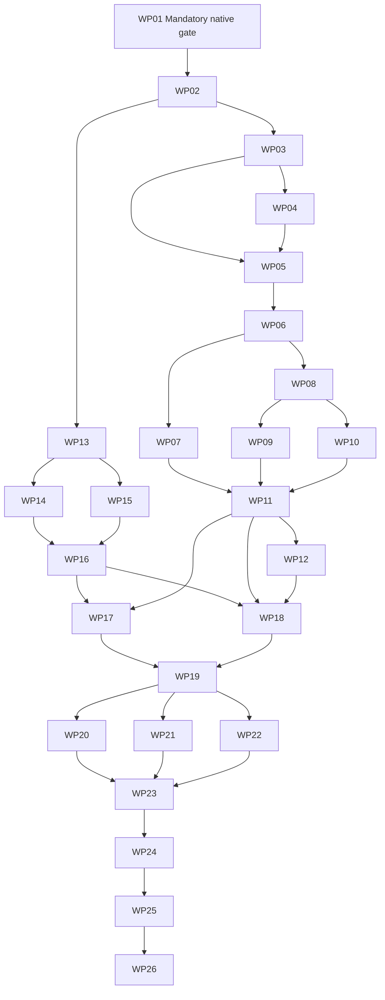

# Optional extensions — work-package breakdown

Mission: `optional-extensions-01M661C0` (`01M661C0T0E4DS0AXBCXG7WCAX`).
Planning base and mission merge target: `feature/optional-extensions`.

Status: independent draft task review is clear subject to metadata corrections. Canonical requirement mapping registered all 24 FRs and auto-committed WP prompts as fb6055982c0756e63f33ca7e3a32d5022234dc85; no manual commit or mutating finalization has been performed by this author. Lane allocation/implementation remain gated. WP01 imports the exact approved beta runtime foundation into its assigned execution lane; primary is preserved.

## Mandatory execution gates

1. WP01 merges exact f8c68bebbaa3845d1eaaac02e3638f30dc062bbd in its assigned lane, imports exact approved scale-test blob 04f9587e36b571779153a8e783072d85ec22f6f3 from c2a2c271, and verifies 219 Go inputs/runtime digest. Preserve primary and exclude incomplete beta WP09 pilot/acceptance ancestry.
2. WP01 independently assesses and minimally fixes the Git-dependent issue23 test fixture, retaining healthy/corrupt/missing-promisor/no-fetch controls. Capture the valid native baseline only after prerequisites pass.
3. WP01 must be **approved before any other WP starts**. Every dependency path below includes WP01. No extension feature can trade away this hard owner requirement.
4. WP02 freezes complete mechanism contracts and is independently approved before artifact/host implementation. Semantic changes return to spec/plan review.
5. Root runs canonical requirement mapping/finalize preflight, finalization and mission analyze readiness before implementation; actual lane worktrees come from lanes.json.
6. Default/native/history and measured performance remain release-blocking through WP24/WP25; platform/adopter evidence absent from the environment stays pending.

## Subtask index

| Subtask | Description | Work package | Parallel |
|---|---|---|---|
| T001 | Verify the exact approved integrated beta prerequisite | WP01 | — |
| T002 | Correct the Git-dependent issue23 fixture without weakening its contract | WP01 | — |
| T003 | Capture unchanged native journeys and historical fixtures | WP01 | — |
| T004 | Build no-loader and forbidden-effect negative controls | WP01 | — |
| T005 | Record paired release measurements and package identities | WP01 | — |
| T006 | Freeze and hand off the baseline for independent approval | WP01 | — |
| T007 | Pin signed artifact bytes, identities and ref grammar | WP02 | — |
| T008 | Pin pure schemas, collections and diagnostic boundaries | WP02 | — |
| T009 | Pin every host request, response, registration and grant shape | WP02 | — |
| T010 | Pin observation, CLI and provenance conformance scenarios | WP02 | — |
| T011 | Publish implementation vectors for independent contract review | WP02 | — |
| T012 | Implement closed envelopes and exact canonical encoding | WP03 | [P] |
| T013 | Validate attribution and actor stream envelope continuity | WP03 | [P] |
| T014 | Apply bounded parsing at consumption time | WP03 | [P] |
| T015 | Create independent signed envelope conformance vectors | WP03 | [P] |
| T016 | Validate namespaced immutable type declarations | WP04 | — |
| T017 | Implement the finite pure schema subset | WP04 | — |
| T018 | Preserve text, ordered members and typed relationships | WP04 | — |
| T019 | Specify evolution without rewriting historical meanings | WP04 | — |
| T020 | Write additive actor streams with native signer mediation | WP05 | — |
| T021 | Load verified selected artifact histories under read budgets | WP05 | — |
| T022 | Refuse unsupported contribution writes before private/public effects | WP05 | — |
| T023 | Prove storage using real Git and history integrity | WP05 | — |
| T024 | Build logical record views from verified exact histories | WP06 | — |
| T025 | Implement expected-head revise and explicit all-head resolution | WP06 | — |
| T026 | Validate bounded collection and link reconstruction | WP06 | — |
| T027 | Implement explicit type conversion as a new revision | WP06 | — |
| T028 | Persist bounded immutable actor-scoped intent | WP07 | — |
| T029 | Recover public operation identity before current-head checks | WP07 | — |
| T030 | Represent absence, uncertainty and interruptions truthfully | WP07 | — |
| T031 | Exercise recovery at real store boundaries | WP07 | — |
| T032 | Compute exact selected public closure | WP08 | — |
| T033 | Verify complete closure before publication | WP08 | — |
| T034 | Enforce aggregate object, record, depth and traversal budgets | WP08 | — |
| T035 | Prove public-only portability and leak exclusions | WP08 | — |
| T036 | Add explicit custom selection without relaxing native readers | WP09 | — |
| T037 | Validate in quarantine and promote with expected-old refs | WP09 | — |
| T038 | Reconstruct through bare remote and independent clone | WP09 | — |
| T039 | Retain native replication compatibility and document selection | WP09 | — |
| T040 | Export the frozen public artifact exchange envelope | WP10 | — |
| T041 | Consume bounded exchange before publication | WP10 | — |
| T042 | Validate full closure and CAS all promoted refs | WP10 | — |
| T043 | Prove independent plugin-free reconstruction and leaks | WP10 | — |
| T044 | Expose frozen native artifact command vocabulary | WP11 | — |
| T045 | Expose public operation lookup and immutable replay | WP11 | — |
| T046 | Expose plugin-free export/import and unknown data inspection | WP11 | — |
| T047 | Exercise full public artifact journeys | WP11 | — |
| T048 | Filter exact generic content and public metadata | WP12 | — |
| T049 | Enforce finite regex parsing and whole-selection work | WP12 | — |
| T050 | Implement bounded stable search result paging | WP12 | — |
| T051 | Prove public search without consumer execution | WP12 | — |
| T052 | Parse strict bounded inert manifests | WP13 | [P] |
| T053 | Store explicit user-local registration identity | WP13 | [P] |
| T054 | Expose explicit lifecycle command registration | WP13 | [P] |
| T055 | Report declaration compatibility and observed availability honestly | WP13 | [P] |
| T056 | Resolve physical repository identity and local enablement | WP14 | — |
| T057 | Validate closed repository family/type/action grant sets | WP14 | — |
| T058 | Expose deliberate enable/disable and inventory views | WP14 | — |
| T059 | Prove raw grant decisions before native effects | WP14 | — |
| T060 | Implement finite length-delimited strict JSON frames | WP15 | [P] |
| T061 | Define typed method routing and closed results/errors | WP15 | [P] |
| T062 | Support one outstanding request and cancellation semantics | WP15 | [P] |
| T063 | Create independent raw frame conformance controls | WP15 | [P] |
| T064 | Launch explicit registered executable with session-bound identity | WP16 | — |
| T065 | Classify long-lived host outside whole-command native write locks | WP16 | — |
| T066 | Enforce request watchdogs stderr and finite cleanup | WP16 | — |
| T067 | Run real child fault and containment matrix | WP16 | — |
| T068 | Adapt public identity and supported native reads | WP17 | — |
| T069 | Route typed writes through shared native authorization boundaries | WP17 | — |
| T070 | Expose native operation lookup and immutable replay | WP17 | — |
| T071 | Prove every advertised native family through raw stdio | WP17 | — |
| T072 | Expose typed generic artifact reads search and type inspection | WP18 | — |
| T073 | Enforce distinct type publish create revise and resolve grants | WP18 | — |
| T074 | Expose durable artifact operation lookup and uncertainty | WP18 | — |
| T075 | Prove raw method inventory and bounded results | WP18 | — |
| T076 | Capture from shared verified accepted visible projections | WP19 | — |
| T077 | Page bounded retained capture sessions | WP19 | — |
| T078 | Implement bounded since catch-up and view invalidation | WP19 | — |
| T079 | Prove observation through raw host requests and live mutations | WP19 | — |
| T080 | Implement standalone fake tracker using only public contract | WP20 | [P] |
| T081 | Persist connector-owned external and native immutable intent | WP20 | [P] |
| T082 | Prove import lost acknowledgement and safe observed export | WP20 | [P] |
| T083 | Exercise stale conflicts disconnects and private boundaries | WP20 | [P] |
| T084 | Define representative generic schemas outside core | WP21 | [P] |
| T085 | Publish related records and explicit exact selection | WP21 | [P] |
| T086 | Demonstrate revision conflict and schema evolution | WP21 | [P] |
| T087 | Remove consumer and reconstruct publicly on independent clone | WP21 | [P] |
| T088 | Build an unrelated standalone model through same interface | WP22 | [P] |
| T089 | Create revise conflict and explicitly convert records | WP22 | [P] |
| T090 | Search and exchange selected unrelated public history | WP22 | [P] |
| T091 | Demonstrate no domain-special core branches or activation | WP22 | [P] |
| T092 | Document optional lifecycle and complete capability matrix | WP23 | — |
| T093 | Document immutable recovery and observation recipes | WP23 | — |
| T094 | Publish portable artifact wire and generic semantics | WP23 | — |
| T095 | Explain process trust and native compatibility without new setup | WP23 | — |
| T096 | Repeat baseline native journeys across every failure configuration | WP24 | — |
| T097 | Prove zero registry parsing starts providers and local writes | WP24 | — |
| T098 | Compare 30 paired release elapsed and RSS observations | WP24 | — |
| T099 | Bind default and historical evidence to final source | WP24 | — |
| T100 | Build fixed-source standard and combined native-only packages | WP25 | — |
| T101 | Run appropriate fixed-head Go checks in serialized heavy execution | WP25 | — |
| T102 | Execute exact packages on each claimed target and variant | WP25 | — |
| T103 | Reconcile limits private-state and clone evidence | WP25 | — |
| T104 | Review host protocol and trust boundaries independently | WP26 | — |
| T105 | Observe a new native user following unchanged native guide | WP26 | — |
| T106 | Observe an independent extension author using published guide | WP26 | — |
| T107 | Reconcile final readiness without beta release or main changes | WP26 | — |

This is a reference index. Subtask completion is event-sourced using `spec-kitty agent tasks mark-status Txxx --status done --mission optional-extensions-01M661C0`; no checkboxes are used. `[P]` indicates package/file independence after all approvals, not subtask status.

## Dependency DAG

The first three implementation tracks after contract freeze are artifact model (WP03), local registration (WP13) and framing (WP15). Store/revision/intent/closure concerns are separate, as are Git/file transport, generic CLI/search, grants/lifecycle/native adapters/custom adapters/observation. External consumers WP20/WP21/WP22 are independent after observation approval. They join before maintained guides and the final default/package/independent gates. Heavy local execution remains serialized.

## Work packages

### WP01 — Default native baseline and integrated prerequisites

- **Priority**: P1; **Profile**: `implementer-ivan` via actual tool `codex`.
- **Dependencies**: none; mandatory first baseline gate.
- **Prompt**: [tasks/WP01-default-native-baseline.md](tasks/WP01-default-native-baseline.md); 6 subtasks, 285 lines.
- **Independent test**: Live native CLI plus original historical inputs; detector red control; healthy and corruption inventory controls; raw baseline metrics.
- **Risks**: Baseline captured before approved beta integration or after extension implementation would be invalid.
- **Requirement refs**: FR-001, FR-002, FR-017, NFR-001, NFR-002, NFR-005, C-001, C-002, C-006, C-010.

**Included subtasks** (reference rows; event-sourced completion):

T001 Verify the exact approved integrated beta prerequisite (WP01)
T002 Correct the Git-dependent issue23 fixture without weakening its contract (WP01)
T003 Capture unchanged native journeys and historical fixtures (WP01)
T004 Build no-loader and forbidden-effect negative controls (WP01)
T005 Record paired release measurements and package identities (WP01)
T006 Freeze and hand off the baseline for independent approval (WP01)

**Implementation sketch**: Verify the exact approved integrated beta prerequisite → Correct the Git-dependent issue23 fixture without weakening its contract → Capture unchanged native journeys and historical fixtures → Build no-loader and forbidden-effect negative controls → Record paired release measurements and package identities → Freeze and hand off the baseline for independent approval.

**Ownership**: `replication_borrow_test.go`, `extension_default_baseline_test.go`, `docs/qualification/optional-extensions/baseline/manifest.json`, `docs/qualification/optional-extensions/baseline/native-outcomes.json`, `docs/qualification/optional-extensions/baseline/historical-hashes.json`, `docs/qualification/optional-extensions/baseline/metrics.csv`, `docs/qualification/optional-extensions/baseline/prerequisites.md`, `beta_scale_test.go`.

**Parallel opportunities**: Only after listed approvals and within disjoint declared file ownership; computed lanes are authoritative. No package may begin merely because a dependency prompt exists.

### WP02 — Freeze portable artifact and host contracts

- **Priority**: P1; **Profile**: `architect-alphonso` via actual tool `codex`.
- **Dependencies**: WP01.
- **Prompt**: [tasks/WP02-freeze-extension-contracts.md](tasks/WP02-freeze-extension-contracts.md); 5 subtasks, 260 lines.
- **Independent test**: Independent read-through can derive complete wire bytes and send handwritten valid/invalid requests without source-private assumptions.
- **Risks**: Method names and illustrative digest placeholders are insufficient contracts; mechanisms may be pinned, but scope changes require root review.
- **Requirement refs**: FR-004, FR-005, FR-007, FR-008, FR-009, FR-010, FR-011, FR-012, FR-014, FR-015, FR-016, FR-019, FR-020, FR-024, NFR-003, C-006, C-008.

**Included subtasks** (reference rows; event-sourced completion):

T007 Pin signed artifact bytes, identities and ref grammar (WP02)
T008 Pin pure schemas, collections and diagnostic boundaries (WP02)
T009 Pin every host request, response, registration and grant shape (WP02)
T010 Pin observation, CLI and provenance conformance scenarios (WP02)
T011 Publish implementation vectors for independent contract review (WP02)

**Implementation sketch**: Pin signed artifact bytes, identities and ref grammar → Pin pure schemas, collections and diagnostic boundaries → Pin every host request, response, registration and grant shape → Pin observation, CLI and provenance conformance scenarios → Publish implementation vectors for independent contract review.

**Ownership**: `kitty-specs/optional-extensions-01M661C0/contracts/artifact-v1.md`, `kitty-specs/optional-extensions-01M661C0/contracts/host-v1.md`, `kitty-specs/optional-extensions-01M661C0/contracts/default-workflow.md`, `kitty-specs/optional-extensions-01M661C0/contracts/conformance-fixtures.md`.

**Parallel opportunities**: Only after listed approvals and within disjoint declared file ownership; computed lanes are authoritative. No package may begin merely because a dependency prompt exists.

### WP03 — Canonical signed artifact envelope

- **Priority**: P1; **Profile**: `implementer-ivan` via actual tool `codex`.
- **Dependencies**: WP02.
- **Prompt**: [tasks/WP03-canonical-artifact-envelope.md](tasks/WP03-canonical-artifact-envelope.md); 4 subtasks, 241 lines.
- **Independent test**: Frozen independent byte vectors and signature tamper controls, later reused through live store and public CLI.
- **Risks**: Reusing native utilities must not share mutable wire format or relax existing unknown-kind validation.
- **Requirement refs**: FR-009, FR-010, FR-015, FR-018, FR-020, NFR-003, C-006.

**Included subtasks** (reference rows; event-sourced completion):

T012 Implement closed envelopes and exact canonical encoding (WP03)
T013 Validate attribution and actor stream envelope continuity (WP03)
T014 Apply bounded parsing at consumption time (WP03)
T015 Create independent signed envelope conformance vectors (WP03)

**Implementation sketch**: Implement closed envelopes and exact canonical encoding → Validate attribution and actor stream envelope continuity → Apply bounded parsing at consumption time → Create independent signed envelope conformance vectors.

**Ownership**: `internal/artifact/envelope.go`, `internal/artifact/canonical.go`, `internal/artifact/envelope_test.go`, `internal/artifact/canonical_test.go`, `artifact_commands.go`, `artifact_envelope_commands.go`, `artifact_envelope_commands_test.go`.

**Parallel opportunities**: Only after listed approvals and within disjoint declared file ownership; computed lanes are authoritative. No package may begin merely because a dependency prompt exists.

### WP04 — Bounded type schemas and generic content

- **Priority**: P1; **Profile**: `implementer-ivan` via actual tool `codex`.
- **Dependencies**: WP03.
- **Prompt**: [tasks/WP04-bounded-artifact-schemas.md](tasks/WP04-bounded-artifact-schemas.md); 4 subtasks, 238 lines.
- **Independent test**: Pure exported validation contracts with hostile declarative schemas, followed by WP11/WP22 live unrelated-model proof.
- **Risks**: General-purpose schema fallback or automatic schema upgrades would expand authority and reinterpret signed history.
- **Requirement refs**: FR-009, FR-010, FR-012, FR-015, FR-016, NFR-003, C-010.

**Included subtasks** (reference rows; event-sourced completion):

T016 Validate namespaced immutable type declarations (WP04)
T017 Implement the finite pure schema subset (WP04)
T018 Preserve text, ordered members and typed relationships (WP04)
T019 Specify evolution without rewriting historical meanings (WP04)

**Implementation sketch**: Validate namespaced immutable type declarations → Implement the finite pure schema subset → Preserve text, ordered members and typed relationships → Specify evolution without rewriting historical meanings.

**Ownership**: `internal/artifact/schema.go`, `internal/artifact/content.go`, `internal/artifact/schema_test.go`, `internal/artifact/content_test.go`, `artifact_schema_commands.go`, `artifact_schema_commands_test.go`.

**Parallel opportunities**: Only after listed approvals and within disjoint declared file ownership; computed lanes are authoritative. No package may begin merely because a dependency prompt exists.

### WP05 — Signed artifact Git storage and accepted reads

- **Priority**: P1; **Profile**: `implementer-ivan` via actual tool `codex`.
- **Dependencies**: WP03, WP04.
- **Prompt**: [tasks/WP05-signed-artifact-storage.md](tasks/WP05-signed-artifact-storage.md); 4 subtasks, 241 lines.
- **Independent test**: Real Git object/ref inspection plus tamper/CAS/contribution refusal controls; public CLI caller proof arrives in WP11.
- **Risks**: A new alternate native writer, implicit key initialization or custom-policy bypass violates the mission boundary.
- **Requirement refs**: FR-010, FR-011, FR-014, FR-015, FR-017, FR-018, NFR-003, NFR-005, C-006.

**Included subtasks** (reference rows; event-sourced completion):

T020 Write additive actor streams with native signer mediation (WP05)
T021 Load verified selected artifact histories under read budgets (WP05)
T022 Refuse unsupported contribution writes before private/public effects (WP05)
T023 Prove storage using real Git and history integrity (WP05)

**Implementation sketch**: Write additive actor streams with native signer mediation → Load verified selected artifact histories under read budgets → Refuse unsupported contribution writes before private/public effects → Prove storage using real Git and history integrity.

**Ownership**: `artifact_store.go`, `artifact_read.go`, `artifact_store_test.go`, `artifact_read_test.go`, `artifact_store_commands.go`, `artifact_store_commands_test.go`, `internal/artifact/canonical_export.go`. The last path is a minimal strict canonicalization wrapper used by the current writer/CLI; WP03 parser source remains unchanged.

**Parallel opportunities**: Only after listed approvals and within disjoint declared file ownership; computed lanes are authoritative. No package may begin merely because a dependency prompt exists.

### WP06 — Collaborative artifact revisions and catalogs

- **Priority**: P1; **Profile**: `implementer-ivan` via actual tool `codex`.
- **Dependencies**: WP05.
- **Prompt**: [tasks/WP06-artifact-revision-catalog.md](tasks/WP06-artifact-revision-catalog.md); 4 subtasks, 236 lines.
- **Independent test**: Two actual actor streams, source-order permutations, stale/all-head negative controls and exact reconstructed state.
- **Risks**: Catalog shortcuts must not drop conflicts or silently substitute the newest schema.
- **Requirement refs**: FR-011, FR-012, FR-015, FR-016, NFR-003.

**Included subtasks** (reference rows; event-sourced completion):

T024 Build logical record views from verified exact histories (WP06)
T025 Implement expected-head revise and explicit all-head resolution (WP06)
T026 Validate bounded collection and link reconstruction (WP06)
T027 Implement explicit type conversion as a new revision (WP06)

**Implementation sketch**: Build logical record views from verified exact histories → Implement expected-head revise and explicit all-head resolution → Validate bounded collection and link reconstruction → Implement explicit type conversion as a new revision.

**Ownership**: `artifact_catalog.go`, `artifact_revision.go`, `artifact_catalog_test.go`, `artifact_revision_test.go`, `artifact_revision_commands.go`, `artifact_revision_commands_test.go`, `internal/artifact/revision_export.go`, `internal/artifact/revision_export_test.go`.

**Parallel opportunities**: Only after listed approvals and within disjoint declared file ownership; computed lanes are authoritative. No package may begin merely because a dependency prompt exists.

### WP07 — Durable artifact intent and exact recovery

- **Priority**: P1; **Profile**: `implementer-ivan` via actual tool `codex`.
- **Dependencies**: WP06.
- **Prompt**: [tasks/WP07-artifact-operation-recovery.md](tasks/WP07-artifact-operation-recovery.md); 4 subtasks, 230 lines.
- **Independent test**: Real store fault stages plus actual restart and immutable replay controls; later WP11/WP18 call the same recovery seam.
- **Risks**: A journal record alone is not public success; absence cannot be inferred from any read error.
- **Requirement refs**: FR-007, FR-011, FR-018, FR-020, NFR-006.

**Included subtasks** (reference rows; event-sourced completion):

T028 Persist bounded immutable actor-scoped intent (WP07)
T029 Recover public operation identity before current-head checks (WP07)
T030 Represent absence, uncertainty and interruptions truthfully (WP07)
T031 Exercise recovery at real store boundaries (WP07)

**Implementation sketch**: Persist bounded immutable actor-scoped intent → Recover public operation identity before current-head checks → Represent absence, uncertainty and interruptions truthfully → Exercise recovery at real store boundaries.

**Ownership**: `artifact_operation.go`, `artifact_operation_test.go`, `artifact_operation_commands.go`, `artifact_operation_commands_test.go`.

**Parallel opportunities**: Only after listed approvals and within disjoint declared file ownership; computed lanes are authoritative. No package may begin merely because a dependency prompt exists.

### WP08 — Artifact dependency closure and verification

- **Priority**: P1; **Profile**: `implementer-ivan` via actual tool `codex`.
- **Dependencies**: WP06.
- **Prompt**: [tasks/WP08-artifact-dependency-closure.md](tasks/WP08-artifact-dependency-closure.md); 4 subtasks, 232 lines.
- **Independent test**: Actual signed Git dependency sets, removed-schema/corrupt-object controls and private-marker export audit.
- **Risks**: Truncated closure or source-machine object borrowing can make a false independent-clone proof.
- **Requirement refs**: FR-012, FR-014, FR-015, FR-018, NFR-003, NFR-006, NFR-008.

**Included subtasks** (reference rows; event-sourced completion):

T032 Compute exact selected public closure (WP08)
T033 Verify complete closure before publication (WP08)
T034 Enforce aggregate object, record, depth and traversal budgets (WP08)
T035 Prove public-only portability and leak exclusions (WP08)

**Implementation sketch**: Compute exact selected public closure → Verify complete closure before publication → Enforce aggregate object, record, depth and traversal budgets → Prove public-only portability and leak exclusions.

**Ownership**: `artifact_closure.go`, `artifact_closure_test.go`, `artifact_closure_commands.go`, `artifact_closure_commands_test.go`.

**Parallel opportunities**: Only after listed approvals and within disjoint declared file ownership; computed lanes are authoritative. No package may begin merely because a dependency prompt exists.

### WP09 — Selected custom Git replication

- **Priority**: P1; **Profile**: `implementer-ivan` via actual tool `codex`.
- **Dependencies**: WP08.
- **Prompt**: [tasks/WP09-artifact-git-replication.md](tasks/WP09-artifact-git-replication.md); 4 subtasks, 232 lines.
- **Independent test**: Two physical clones and a real bare remote, quarantine tamper/missing-dependency controls and original native refusal suite.
- **Risks**: Only this WP owns replication.go/quarantine.go; re-inspect integrated beta changes before touching them.
- **Requirement refs**: FR-014, FR-015, FR-017, NFR-003, NFR-005, NFR-008, C-006.

**Included subtasks** (reference rows; event-sourced completion):

T036 Add explicit custom selection without relaxing native readers (WP09)
T037 Validate in quarantine and promote with expected-old refs (WP09)
T038 Reconstruct through bare remote and independent clone (WP09)
T039 Retain native replication compatibility and document selection (WP09)

**Implementation sketch**: Add explicit custom selection without relaxing native readers → Validate in quarantine and promote with expected-old refs → Reconstruct through bare remote and independent clone → Retain native replication compatibility and document selection.

**Ownership**: `artifact_replication.go`, `artifact_replication_test.go`, `replication.go`, `quarantine.go`, `docs/replication-v0.md`.

**Parallel opportunities**: Only after listed approvals and within disjoint declared file ownership; computed lanes are authoritative. No package may begin merely because a dependency prompt exists.

### WP10 — Bounded selected artifact file exchange

- **Priority**: P1; **Profile**: `implementer-ivan` via actual tool `codex`.
- **Dependencies**: WP08.
- **Prompt**: [tasks/WP10-artifact-file-exchange.md](tasks/WP10-artifact-file-exchange.md); 4 subtasks, 231 lines.
- **Independent test**: Real regular files, independently initialized destination, bounded-consumption cases and no-effects snapshot checks.
- **Risks**: File exchange and Git transport share closure rules; neither may imply authority adoption.
- **Requirement refs**: FR-014, FR-015, FR-018, NFR-003, NFR-006, NFR-008.

**Included subtasks** (reference rows; event-sourced completion):

T040 Export the frozen public artifact exchange envelope (WP10)
T041 Consume bounded exchange before publication (WP10)
T042 Validate full closure and CAS all promoted refs (WP10)
T043 Prove independent plugin-free reconstruction and leaks (WP10)

**Implementation sketch**: Export the frozen public artifact exchange envelope → Consume bounded exchange before publication → Validate full closure and CAS all promoted refs → Prove independent plugin-free reconstruction and leaks.

**Ownership**: `artifact_exchange.go`, `artifact_exchange_test.go`, `artifact_exchange_commands.go`, `artifact_exchange_commands_test.go`.

**Parallel opportunities**: Only after listed approvals and within disjoint declared file ownership; computed lanes are authoritative. No package may begin merely because a dependency prompt exists.

### WP11 — Generic artifact CLI and public recovery interface

- **Priority**: P1; **Profile**: `implementer-ivan` via actual tool `codex`.
- **Dependencies**: WP07, WP09, WP10.
- **Prompt**: [tasks/WP11-generic-artifact-cli.md](tasks/WP11-generic-artifact-cli.md); 4 subtasks, 234 lines.
- **Independent test**: Live built hn CLI exercises model/schema/store/recovery/transport with negative controls; no registry or specialized plugin required.
- **Risks**: Generic CLI must not become a doctrine-specific renderer or alternate native mutation implementation.
- **Requirement refs**: FR-007, FR-009, FR-010, FR-011, FR-012, FR-013, FR-014, FR-015, FR-016, FR-020.

**Included subtasks** (reference rows; event-sourced completion):

T044 Expose frozen native artifact command vocabulary (WP11)
T045 Expose public operation lookup and immutable replay (WP11)
T046 Expose plugin-free export/import and unknown data inspection (WP11)
T047 Exercise full public artifact journeys (WP11)

**Implementation sketch**: Expose frozen native artifact command vocabulary → Expose public operation lookup and immutable replay → Expose plugin-free export/import and unknown data inspection → Exercise full public artifact journeys.

**Ownership**: `artifact_commands_test.go`, `artifact_acceptance_test.go`, `artifact_query_commands.go`.

**Parallel opportunities**: Only after listed approvals and within disjoint declared file ownership; computed lanes are authoritative. No package may begin merely because a dependency prompt exists.

### WP12 — Generic artifact filters and bounded regex search

- **Priority**: P1; **Profile**: `implementer-ivan` via actual tool `codex`.
- **Dependencies**: WP11.
- **Prompt**: [tasks/WP12-artifact-search.md](tasks/WP12-artifact-search.md); 4 subtasks, 226 lines.
- **Independent test**: Live plugin-free search, explicit over-budget patterns, stale selection and process-marker red controls.
- **Risks**: Reusing search ideas must not couple artifact inspection to memory activation or application semantics.
- **Requirement refs**: FR-013, FR-015, NFR-003, C-010.

**Included subtasks** (reference rows; event-sourced completion):

T048 Filter exact generic content and public metadata (WP12)
T049 Enforce finite regex parsing and whole-selection work (WP12)
T050 Implement bounded stable search result paging (WP12)
T051 Prove public search without consumer execution (WP12)

**Implementation sketch**: Filter exact generic content and public metadata → Enforce finite regex parsing and whole-selection work → Implement bounded stable search result paging → Prove public search without consumer execution.

**Ownership**: `artifact_search.go`, `artifact_search_test.go`, `artifact_search_acceptance_test.go`.

**Parallel opportunities**: Only after listed approvals and within disjoint declared file ownership; computed lanes are authoritative. No package may begin merely because a dependency prompt exists.

### WP13 — Inert local registration and discovery

- **Priority**: P1; **Profile**: `implementer-ivan` via actual tool `codex`.
- **Dependencies**: WP02.
- **Prompt**: [tasks/WP13-extension-registration.md](tasks/WP13-extension-registration.md); 4 subtasks, 238 lines.
- **Independent test**: Live extension inspect/register plus native commands, missing/malformed configuration and deliberate process/read detectors.
- **Risks**: Local registration is neither repository authority nor a general package manager.
- **Requirement refs**: FR-002, FR-003, FR-004, NFR-001, NFR-006, C-002, C-003.

**Included subtasks** (reference rows; event-sourced completion):

T052 Parse strict bounded inert manifests (WP13)
T053 Store explicit user-local registration identity (WP13)
T054 Expose explicit lifecycle command registration (WP13)
T055 Report declaration compatibility and observed availability honestly (WP13)

**Implementation sketch**: Parse strict bounded inert manifests → Store explicit user-local registration identity → Expose explicit lifecycle command registration → Report declaration compatibility and observed availability honestly.

**Ownership**: `internal/extension/manifest.go`, `internal/extension/registration.go`, `internal/extension/manifest_test.go`, `internal/extension/registration_test.go`, `extension_commands.go`, `extension_registration_test.go`.

**Parallel opportunities**: Only after listed approvals and within disjoint declared file ownership; computed lanes are authoritative. No package may begin merely because a dependency prompt exists.

### WP14 — Repository binding and per-action grants

- **Priority**: P1; **Profile**: `implementer-ivan` via actual tool `codex`.
- **Dependencies**: WP13.
- **Prompt**: [tasks/WP14-extension-grants.md](tasks/WP14-extension-grants.md); 4 subtasks, 232 lines.
- **Independent test**: Canonical repository alias cases, local lifecycle CLI, raw authorization vectors and prohibited-effect red controls.
- **Risks**: Host restrictions supplement native policy; they never modify historical native signer validity.
- **Requirement refs**: FR-003, FR-004, FR-005, FR-017, NFR-006, C-003, C-008.

**Included subtasks** (reference rows; event-sourced completion):

T056 Resolve physical repository identity and local enablement (WP14)
T057 Validate closed repository family/type/action grant sets (WP14)
T058 Expose deliberate enable/disable and inventory views (WP14)
T059 Prove raw grant decisions before native effects (WP14)

**Implementation sketch**: Resolve physical repository identity and local enablement → Validate closed repository family/type/action grant sets → Expose deliberate enable/disable and inventory views → Prove raw grant decisions before native effects.

**Ownership**: `internal/extension/grants.go`, `internal/extension/grants_test.go`, `extension_enablement.go`, `extension_enablement_test.go`.

**Parallel opportunities**: Only after listed approvals and within disjoint declared file ownership; computed lanes are authoritative. No package may begin merely because a dependency prompt exists.

### WP15 — Strict framed stdio protocol

- **Priority**: P1; **Profile**: `implementer-ivan` via actual tool `codex`.
- **Dependencies**: WP13.
- **Prompt**: [tasks/WP15-extension-framing.md](tasks/WP15-extension-framing.md); 4 subtasks, 236 lines.
- **Independent test**: Independent handwritten byte streams, allocation-bound inputs and later real process stdio conformance.
- **Risks**: Transport cancellation is not proof a dispatched mutation had no effect.
- **Requirement refs**: FR-005, FR-019, FR-020, NFR-003, C-009.

**Included subtasks** (reference rows; event-sourced completion):

T060 Implement finite length-delimited strict JSON frames (WP15)
T061 Define typed method routing and closed results/errors (WP15)
T062 Support one outstanding request and cancellation semantics (WP15)
T063 Create independent raw frame conformance controls (WP15)

**Implementation sketch**: Implement finite length-delimited strict JSON frames → Define typed method routing and closed results/errors → Support one outstanding request and cancellation semantics → Create independent raw frame conformance controls.

**Ownership**: `internal/extension/protocol.go`, `internal/extension/frame.go`, `internal/extension/protocol_test.go`, `internal/extension/frame_test.go`, `extension_protocol_commands.go`, `extension_protocol_commands_test.go`.

**Parallel opportunities**: Only after listed approvals and within disjoint declared file ownership; computed lanes are authoritative. No package may begin merely because a dependency prompt exists.

### WP16 — Explicit host launch and bounded child lifecycle

- **Priority**: P1; **Profile**: `implementer-ivan` via actual tool `codex`.
- **Dependencies**: WP14, WP15.
- **Prompt**: [tasks/WP16-extension-host-lifecycle.md](tasks/WP16-extension-host-lifecycle.md); 4 subtasks, 245 lines.
- **Independent test**: Actual hn host and external processes, observed PID exit, competing native request, timeout/oversize/secret controls.
- **Risks**: Same-user process powers remain filesystem powers; do not claim sandboxing or bypass beta admission via lock classification.
- **Requirement refs**: FR-003, FR-005, FR-019, FR-020, NFR-001, NFR-003, NFR-004, NFR-006, C-002, C-007, C-009.

**Included subtasks** (reference rows; event-sourced completion):

T064 Launch explicit registered executable with session-bound identity (WP16)
T065 Classify long-lived host outside whole-command native write locks (WP16)
T066 Enforce request watchdogs stderr and finite cleanup (WP16)
T067 Run real child fault and containment matrix (WP16)

**Implementation sketch**: Launch explicit registered executable with session-bound identity → Classify long-lived host outside whole-command native write locks → Enforce request watchdogs stderr and finite cleanup → Run real child fault and containment matrix.

**Ownership**: `internal/extension/session.go`, `internal/extension/process.go`, `internal/extension/session_test.go`, `internal/extension/process_test.go`, `extension_host_command.go`, `extension_host_lifecycle_test.go`, `main.go`.

**Parallel opportunities**: Only after listed approvals and within disjoint declared file ownership; computed lanes are authoritative. No package may begin merely because a dependency prompt exists.

### WP17 — Native operation adapters with exact recovery

- **Priority**: P1; **Profile**: `implementer-ivan` via actual tool `codex`.
- **Dependencies**: WP16, WP11.
- **Prompt**: [tasks/WP17-extension-native-adapters.md](tasks/WP17-extension-native-adapters.md); 4 subtasks, 242 lines.
- **Independent test**: Raw external stdio to live hn plus real native actors/contribution policy and forbidden-effect controls per family.
- **Risks**: Calling an internal native helper without its integrated outer policy/lock boundary would silently bypass authority.
- **Requirement refs**: FR-004, FR-005, FR-006, FR-007, FR-017, FR-018, FR-020, C-008.

**Included subtasks** (reference rows; event-sourced completion):

T068 Adapt public identity and supported native reads (WP17)
T069 Route typed writes through shared native authorization boundaries (WP17)
T070 Expose native operation lookup and immutable replay (WP17)
T071 Prove every advertised native family through raw stdio (WP17)

**Implementation sketch**: Adapt public identity and supported native reads → Route typed writes through shared native authorization boundaries → Expose native operation lookup and immutable replay → Prove every advertised native family through raw stdio.

**Ownership**: `extension_native_adapter.go`, `extension_native_adapter_test.go`, `extension_native_acceptance_test.go`, `contribution_moderation.go`, `resource_engine.go`, `issue_commands.go`.

**Parallel opportunities**: Only after listed approvals and within disjoint declared file ownership; computed lanes are authoritative. No package may begin merely because a dependency prompt exists.

### WP18 — Artifact operation adapters and capability inventory

- **Priority**: P1; **Profile**: `implementer-ivan` via actual tool `codex`.
- **Dependencies**: WP16, WP11, WP12.
- **Prompt**: [tasks/WP18-extension-artifact-adapters.md](tasks/WP18-extension-artifact-adapters.md); 4 subtasks, 233 lines.
- **Independent test**: Live raw stdio custom model round trips, policy/grant negatives, full-state bounds and exact operation replay.
- **Risks**: Do not expand generic host grants into governance, implicit type activation or private-state export.
- **Requirement refs**: FR-004, FR-005, FR-007, FR-009, FR-011, FR-013, FR-015, FR-017, FR-020.

**Included subtasks** (reference rows; event-sourced completion):

T072 Expose typed generic artifact reads search and type inspection (WP18)
T073 Enforce distinct type publish create revise and resolve grants (WP18)
T074 Expose durable artifact operation lookup and uncertainty (WP18)
T075 Prove raw method inventory and bounded results (WP18)

**Implementation sketch**: Expose typed generic artifact reads search and type inspection → Enforce distinct type publish create revise and resolve grants → Expose durable artifact operation lookup and uncertainty → Prove raw method inventory and bounded results.

**Ownership**: `extension_artifact_adapter.go`, `extension_artifact_adapter_test.go`, `extension_artifact_acceptance_test.go`.

**Parallel opportunities**: Only after listed approvals and within disjoint declared file ownership; computed lanes are authoritative. No package may begin merely because a dependency prompt exists.

### WP19 — Accepted visible change capture and checkpoints

- **Priority**: P1; **Profile**: `implementer-ivan` via actual tool `codex`.
- **Dependencies**: WP17, WP18.
- **Prompt**: [tasks/WP19-extension-change-observation.md](tasks/WP19-extension-change-observation.md); 4 subtasks, 227 lines.
- **Independent test**: Raw external observer, live native mutations, policy visibility transitions, stale/expired cuts and invalid-history controls.
- **Risks**: Signed validity differs from accepted visibility; current native cursors alone are not durable change checkpoints.
- **Requirement refs**: FR-008, FR-017, FR-020, NFR-003.

**Included subtasks** (reference rows; event-sourced completion):

T076 Capture from shared verified accepted visible projections (WP19)
T077 Page bounded retained capture sessions (WP19)
T078 Implement bounded since catch-up and view invalidation (WP19)
T079 Prove observation through raw host requests and live mutations (WP19)

**Implementation sketch**: Capture from shared verified accepted visible projections → Page bounded retained capture sessions → Implement bounded since catch-up and view invalidation → Prove observation through raw host requests and live mutations.

**Ownership**: `extension_changes.go`, `extension_changes_test.go`, `extension_changes_acceptance_test.go`.

**Parallel opportunities**: Only after listed approvals and within disjoint declared file ownership; computed lanes are authoritative. No package may begin merely because a dependency prompt exists.

### WP20 — Fake tracker external consumer

- **Priority**: P1; **Profile**: `implementer-ivan` via actual tool `codex`.
- **Dependencies**: WP19.
- **Prompt**: [tasks/WP20-fake-tracker-consumer.md](tasks/WP20-fake-tracker-consumer.md); 4 subtasks, 235 lines.
- **Independent test**: Independent executable round trip with lost reply, process restart, external journal and raw grant/echo/conflict controls.
- **Risks**: A helper-only mock cannot prove cross-process recovery; no enterprise connector or global exactly-once claim.
- **Requirement refs**: FR-007, FR-008, FR-018, FR-021, NFR-006, NFR-008, C-005.

**Included subtasks** (reference rows; event-sourced completion):

T080 Implement standalone fake tracker using only public contract (WP20)
T081 Persist connector-owned external and native immutable intent (WP20)
T082 Prove import lost acknowledgement and safe observed export (WP20)
T083 Exercise stale conflicts disconnects and private boundaries (WP20)

**Implementation sketch**: Implement standalone fake tracker using only public contract → Persist connector-owned external and native immutable intent → Prove import lost acknowledgement and safe observed export → Exercise stale conflicts disconnects and private boundaries.

**Ownership**: `examples/extensions/fake-tracker/main.go`, `examples/extensions/fake-tracker/journal.go`, `examples/extensions/fake-tracker/main_test.go`, `examples/extensions/fake-tracker/README.md`, `extension_fake_tracker_acceptance_test.go`.

**Parallel opportunities**: Only after listed approvals and within disjoint declared file ownership; computed lanes are authoritative. No package may begin merely because a dependency prompt exists.

### WP21 — Charter shaped reference data consumer

- **Priority**: P2; **Profile**: `implementer-ivan` via actual tool `codex`.
- **Dependencies**: WP19.
- **Prompt**: [tasks/WP21-charter-model-consumer.md](tasks/WP21-charter-model-consumer.md); 4 subtasks, 234 lines.
- **Independent test**: External generic publisher plus real independent clone and plugin-free inspection; exact old selection and inert-content controls.
- **Risks**: This proves DATA MODEL feasibility only, not a Spec Kitty runtime, charter resolver or production doctrine plugin.
- **Requirement refs**: FR-012, FR-022, NFR-008, C-003, C-004, C-010.

**Included subtasks** (reference rows; event-sourced completion):

T084 Define representative generic schemas outside core (WP21)
T085 Publish related records and explicit exact selection (WP21)
T086 Demonstrate revision conflict and schema evolution (WP21)
T087 Remove consumer and reconstruct publicly on independent clone (WP21)

**Implementation sketch**: Define representative generic schemas outside core → Publish related records and explicit exact selection → Demonstrate revision conflict and schema evolution → Remove consumer and reconstruct publicly on independent clone.

**Ownership**: `examples/extensions/charter-model/main.go`, `examples/extensions/charter-model/model.go`, `examples/extensions/charter-model/main_test.go`, `examples/extensions/charter-model/README.md`, `extension_charter_acceptance_test.go`.

**Parallel opportunities**: Only after listed approvals and within disjoint declared file ownership; computed lanes are authoritative. No package may begin merely because a dependency prompt exists.

### WP22 — Unrelated inventory model proof

- **Priority**: P2; **Profile**: `implementer-ivan` via actual tool `codex`.
- **Dependencies**: WP19.
- **Prompt**: [tasks/WP22-inventory-model-proof.md](tasks/WP22-inventory-model-proof.md); 4 subtasks, 238 lines.
- **Independent test**: Unrelated external executable, both real actors and clone portability, same generic caller/negative cases.
- **Risks**: Reusing charter-specific fixture helpers could conceal a domain-coded core; public consumer must remain independent.
- **Requirement refs**: FR-009, FR-010, FR-011, FR-012, FR-013, FR-014, FR-016, FR-023, NFR-008, C-004.

**Included subtasks** (reference rows; event-sourced completion):

T088 Build an unrelated standalone model through same interface (WP22)
T089 Create revise conflict and explicitly convert records (WP22)
T090 Search and exchange selected unrelated public history (WP22)
T091 Demonstrate no domain-special core branches or activation (WP22)

**Implementation sketch**: Build an unrelated standalone model through same interface → Create revise conflict and explicitly convert records → Search and exchange selected unrelated public history → Demonstrate no domain-special core branches or activation.

**Ownership**: `examples/extensions/inventory-model/main.go`, `examples/extensions/inventory-model/model.go`, `examples/extensions/inventory-model/main_test.go`, `examples/extensions/inventory-model/README.md`, `extension_inventory_acceptance_test.go`.

**Parallel opportunities**: Only after listed approvals and within disjoint declared file ownership; computed lanes are authoritative. No package may begin merely because a dependency prompt exists.

### WP23 — Consumer guides and public boundary documentation

- **Priority**: P1; **Profile**: `curator-carla` via actual tool `codex`.
- **Dependencies**: WP20, WP21, WP22.
- **Prompt**: [tasks/WP23-extension-consumer-documentation.md](tasks/WP23-extension-consumer-documentation.md); 4 subtasks, 237 lines.
- **Independent test**: Copyable actual-binary examples and requirement/capability/error inventory compared with observed contracts.
- **Risks**: Documentation cannot convert unsupported behavior or missing qualification into a pass.
- **Requirement refs**: FR-024, C-002, C-004, C-005, C-007, C-008, C-009, C-010.

**Included subtasks** (reference rows; event-sourced completion):

T092 Document optional lifecycle and complete capability matrix (WP23)
T093 Document immutable recovery and observation recipes (WP23)
T094 Publish portable artifact wire and generic semantics (WP23)
T095 Explain process trust and native compatibility without new setup (WP23)

**Implementation sketch**: Document optional lifecycle and complete capability matrix → Document immutable recovery and observation recipes → Publish portable artifact wire and generic semantics → Explain process trust and native compatibility without new setup.

**Ownership**: `docs/extensions.md`, `docs/artifacts-v1.md`, `docs/extension-consumers.md`, `docs/threat-model.md`, `README.md`.

**Parallel opportunities**: Only after listed approvals and within disjoint declared file ownership; computed lanes are authoritative. No package may begin merely because a dependency prompt exists.

### WP24 — Default workflow and historical acceptance matrix

- **Priority**: P1; **Profile**: `implementer-ivan` via actual tool `codex`.
- **Dependencies**: WP23.
- **Prompt**: [tasks/WP24-default-workflow-qualification.md](tasks/WP24-default-workflow-qualification.md); 4 subtasks, 245 lines.
- **Independent test**: Original live native journeys, all seven configuration rows, historical byte equality and paired raw metrics with red controls.
- **Risks**: Final qualification evidence becomes stale after any implementation change; rerun affected evidence at corrected fixed source.
- **Requirement refs**: FR-001, FR-002, FR-015, FR-017, NFR-001, NFR-002, NFR-003, NFR-004, NFR-005, NFR-006, C-001, C-002, C-006, C-010.

**Included subtasks** (reference rows; event-sourced completion):

T096 Repeat baseline native journeys across every failure configuration (WP24)
T097 Prove zero registry parsing starts providers and local writes (WP24)
T098 Compare 30 paired release elapsed and RSS observations (WP24)
T099 Bind default and historical evidence to final source (WP24)

**Implementation sketch**: Repeat baseline native journeys across every failure configuration → Prove zero registry parsing starts providers and local writes → Compare 30 paired release elapsed and RSS observations → Bind default and historical evidence to final source.

**Ownership**: `extension_default_acceptance_test.go`, `extension_default_performance_test.go`, `docs/qualification/optional-extensions/default/manifest.json`, `docs/qualification/optional-extensions/default/matrix.json`, `docs/qualification/optional-extensions/default/metrics.csv`, `docs/qualification/optional-extensions/default/historical-hashes.json`.

**Parallel opportunities**: Only after listed approvals and within disjoint declared file ownership; computed lanes are authoritative. No package may begin merely because a dependency prompt exists.

### WP25 — Exact package platform and build qualification

- **Priority**: P1; **Profile**: `implementer-ivan` via actual tool `codex`.
- **Dependencies**: WP24.
- **Prompt**: [tasks/WP25-exact-package-qualification.md](tasks/WP25-exact-package-qualification.md); 4 subtasks, 243 lines.
- **Independent test**: Exact distributed-candidate binary execution and fixed-source full suite; platform rows cannot be inferred from cross compilation.
- **Risks**: Missing platform evidence remains pending; this WP cannot waive support claims or publish a release.
- **Requirement refs**: FR-014, FR-019, FR-024, NFR-003, NFR-004, NFR-006, NFR-007, NFR-008, C-002.

**Included subtasks** (reference rows; event-sourced completion):

T100 Build fixed-source standard and combined native-only packages (WP25)
T101 Run appropriate fixed-head Go checks in serialized heavy execution (WP25)
T102 Execute exact packages on each claimed target and variant (WP25)
T103 Reconcile limits private-state and clone evidence (WP25)

**Implementation sketch**: Build fixed-source standard and combined native-only packages → Run appropriate fixed-head Go checks in serialized heavy execution → Execute exact packages on each claimed target and variant → Reconcile limits private-state and clone evidence.

**Ownership**: `.github/workflows/portability.yml`, `.github/workflows/optional-extensions-qualification.yml`, `extension_package_acceptance_test.go`, `docs/qualification/optional-extensions/packages/manifest.json`, `docs/qualification/optional-extensions/packages/platform-matrix.json`, `docs/qualification/optional-extensions/packages/checks.md`.

**Parallel opportunities**: Only after listed approvals and within disjoint declared file ownership; computed lanes are authoritative. No package may begin merely because a dependency prompt exists.

### WP26 — Independent boundaries and adopter evidence

- **Priority**: P1; **Profile**: `reviewer-renata` via actual tool `codex`.
- **Dependencies**: WP25.
- **Prompt**: [tasks/WP26-independent-acceptance-evidence.md](tasks/WP26-independent-acceptance-evidence.md); 4 subtasks, 238 lines.
- **Independent test**: Independent reviewer and actual native-user/author observations tied to exact package; no invented adopter evidence.
- **Risks**: This evidence WP cannot repair code or self-approve missing external observations.
- **Requirement refs**: FR-001, FR-004, FR-017, FR-024, NFR-001, NFR-006, NFR-007, C-001, C-004, C-005, C-007, C-008.

**Included subtasks** (reference rows; event-sourced completion):

T104 Review host protocol and trust boundaries independently (WP26)
T105 Observe a new native user following unchanged native guide (WP26)
T106 Observe an independent extension author using published guide (WP26)
T107 Reconcile final readiness without beta release or main changes (WP26)

**Implementation sketch**: Review host protocol and trust boundaries independently → Observe a new native user following unchanged native guide → Observe an independent extension author using published guide → Reconcile final readiness without beta release or main changes.

**Ownership**: `docs/qualification/optional-extensions/independent/boundary-review.md`, `docs/qualification/optional-extensions/independent/native-user.md`, `docs/qualification/optional-extensions/independent/extension-author.md`, `docs/qualification/optional-extensions/independent/readiness.md`.

**Parallel opportunities**: Only after listed approvals and within disjoint declared file ownership; computed lanes are authoritative. No package may begin merely because a dependency prompt exists.

## Cross-cutting acceptance and ownership notes

- WP01 owns beta_scale_test.go plus minimal deterministic issue23 test correction and baseline harness/evidence; its normal approved-source merge is an explicit dependency-import exception. It does not author production replication changes. WP09 alone owns later replication.go/quarantine.go integration.
- WP16 alone owns main.go host lifetime classification. WP17 owns contribution_moderation.go, resource_engine.go and issue_commands.go for the frozen explicit Context variants and Background wrappers, per-request native command lock and actor/policy/visibility checks, and synchronous completion. This closes analysis O1 through the shared writers, without globals, copied writers, detached publication or changed direct CLI behavior.
- WP25 owns the portability.yml explicit manual extension selector and optional-extensions-qualification.yml reusable workflow. Keep existing beta defaults and PR/push behavior; extension selection suppresses beta manual candidate jobs. Verify actual same-commit feature-ref dispatch, separate caller/workflow and candidate source identities, all eight exact package variants and supplied reference assets, with no source-build fallback or runtime hosting dependency.
- WP13 owns extension command dispatch; WP14/WP16 add handlers through static no-I/O registration. WP03 owns artifact command dispatch and inert envelope validation; WP04 schema validate, WP05 type.publish/open, WP06 revise/resolve/convert, WP07 operation, WP08 closure inspect, WP10 file export/import and WP11 full queries each own a static registered live slice. WP12 search registers through the same no-I/O seam. WP15 framing has inert explicit frame-inspection CLI via WP13; no zero-production-caller debt. No dependency stub or dispatcher path may read registry during native startup.
- WP02 alone uses planning_artifact execution mode for mission contract evolution. WP23 public guides and WP26 independently authored public qualification reports are repository documentation deliveries with code_change execution mode and their original curator/reviewer roles; they own no application code. This avoids collapsing early/late outputs into one lane-planning cycle. Raw/private evidence stays external; committed qualification evidence is sanitized. WP23 owns public guides. Later code WPs must report required contract changes to those owners/root rather than editing overlapping files silently.
- Portable custom stores/refs are additive. Native/memory encoders, signed goldens, admission and recovery meanings are protected.
- Native contribution-selected operations retain shared admission, visibility, reservations and actual signer checks. Custom selected-policy writes are explicitly unsupported before any effects.
- Memory mutations, proposal/review/decide/merge, policy/identity lifecycle, run/runner/audit/automerge and automatic transport/apply remain unsupported host surfaces.
- Reference consumers use public framed host methods, own external journals and credentials, and never import the production main package. Charter-model is DATA MODEL proof only.
- Each published bound requires live-caller at-bound/over-limit proof and no prohibited effects. Detector/control failures are meaningful; helper-only green evidence is insufficient.
- NFR-002 uses 30 retained paired non-race release observations, exact source/host/corpus and fixed median budgets. No retry-to-green or silent threshold relaxation.
- Combined native-only means nogithub,noforge. Each claimed Linux/macOS AMD64/ARM64 standard/native package row needs exact binary execution; missing rows stay pending.
- Independent native-user and extension-author observations are real external evidence; root must arrange them or record a truthful pending gate.
- Beta acceptance, beta pilot, published release and main push remain outside this mission task draft.

## Requirement coverage and finalization handoff

All 24 functional requirements, eight NFRs and ten constraints are referenced in WP frontmatter. These references are registered canonical inputs; validate-only and finalization must succeed before implementation. WP01 then imports the approved foundation in its assigned lane. Do not manually create lanes.json or mutate status/event logs.

Suggested sequence for root: inspect integrated foundation and this ownership map; independent task/contract review; resolve findings; requirement refs already registered (remap only if refs change); finalize-tasks --validate-only; canonical finalize; mission analyze readiness; begin WP01 with independent implement/review agents. All later WP claims remain blocked until WP01 approval.

Execution integration clarification: WP05 owns the currently-used strict intent/evidence reader, lock-owning mutation attempt and sole append/finish boundary required by its existing type/open retries. WP06 reuses it for successors and owns its narrow unsigned-successor payload bridge. WP07 exposes read-only status and proves recovery through those same callers; it does not introduce another writer or edit earlier owners. This preserves non-overlapping execution scopes and the existing 26 lane identities.

- 2026-10-31 root maintenance amendment: WP25 T101–T103 additionally own the eight existing test files enumerated in its dated integration-config-path-maintenance record. Ownership is exclusive and prospective; original authorship/reviews remain historical, every production owner and dependency remains unchanged, and all 26 lane identities/107 subtasks must survive normal finalization. Actual OS path/causal detectors and source-private-key checks must be repaired before the eight native package rows.

## Prospective bounded artifact I/O and qualification correction — 2026-11-01

Root adopts only the exact future integration-artifact-io.md/regions/verification records beside WP25's prior bounded-batch addendum, after complete reap of the H12f8 full source run. WP25 T101–T103 execute five narrow production exceptions under unchanged original owners: artifact_read.go/artifact_store.go (WP05), artifact_closure.go (WP08), artifact_replication.go (WP09), artifact_exchange.go (WP10). An additional TEST-ONLY exception replaces only inventoryHostShapeSearch's unordered separate-ID fetch loop in extension_inventory_acceptance_test.go (WP22) with one deterministic sorted fetch of all three exact final converted IDs; preserve every search/read/privacy assertion and product anti-rewind refusal. No ownership transfer or frontmatter mutation is authorized by this paragraph.

Keep 26 WP/lane identities,107 subtasks, WP25's14 owned paths, all13 create_intent entries, dependencies/authoritative surfaces and historical approvals exact. Full raw-reader sessions retain metadata-before-body/role+unique-byte guards, raw hash, old ls-tree/business verification, count preflight, witnesses and all30/240 budgets. Blob-only ordered ACK copying retains literal commit/tree writes, bounded owned scratch including unreachable exchange-table32MiB acceptance, exact first-detected-error diagnostics and mandatory all-return child ownership/EOF/Wait before any successful history/inventory/copy/ref advance. Qualified OS temp alias normalization stays inside the owned explicit qualification harness before any t.TempDir; arbitrary alias negative controls remain intact. No new Go path/dependency/default work or projectGit/tree-parser/adapter/lock/CLOEXEC/settlement/policy/identity/public-contract change.

The existing TEST-ONLY performance317/311 closed-union exception, numeric budgets, sample selection, ordering, math and controls remain unchanged. Require meaningful retained old/new public/causal controls, fresh independent source review, new root-attested311 hash values/all317 freeze, fresh default/control plus full4320 paired observations, full frozen source and all8 actual native packages, and normal independent WP25 review. No historical result is relabeled or reused as production-changed-source qualification. Normal finalizer planning-commit refresh and fresh analysis readiness precede normal WP25 implementation reentry; no force/skip/hand lifecycle event. No task/verdict/status completion or main/release action is recorded here.

## Prospective native retained-contribution I/O and checkpoint fixture correction — 2026-11-01

After the current H5 local full-source execution is fully reaped and its exact inputs/failure evidence retained, root may adopt only `integration-native-retention-io.md`, `integration-native-retention-io-regions.json` and `integration-native-retention-io-verification.json` beside WP25's existing addenda. This is T101–T103 work under unchanged owners, not a new work package, whole-file transfer or lifecycle verdict. Preserve all26 WP/lane identities,107 subtasks, WP25's14 owned paths,13 create_intent entries, WP24 dependency, authoritative surfaces and historical approvals.

The only new production exceptions are ReadContributionManifest's raw closure plus same-invocation payload/signature reuse in contribution_exchange.go, an adjacent native-local private helper in that existing file, and contributionRegisterRetained's raw closure in contribution_moderation.go. Use TWO SEQUENTIAL classic Git workers: `--batch-check` must admit ALL metadata and complete clean EOF/successful Wait/reap before lazy `--batch` can start. Native stderr remains `io.Discard` with retained storage0 and no cap; do not import artifact stderr limits/errors or require `--batch-command`. Preserve existing bounded enumeration/count/dedup/sort, all supplied limits/deadlines, framed headroom before body request/allocation, exact repeated OID/type/size, raw SHA1/SHA256 identity, original preflight/manifest/ls-tree/role/signature ordering and both independent plan observations. Retain registration locks/reservation/journal/coverage/ref/authority algorithms and permitted charged failure state. No change to shared projectObjectIDs/projectGit/project_snapshot.go, artifact I/O, default initialization/registry behavior, Go paths, dependencies or public protocol.

A separate TEST-ONLY exception in extension_changes_test.go (WP19 approved/inactive) replaces only the filesystem-checkpoint portion of TestExtensionChangesPrivateProofAccountingAndEviction and directly necessary local test helper. Set/read back distinct explicit mtimes and include an alternate creation-vs-mtime-order control; prove oldest-by-mtime eviction, exactly64 descriptors plus key/lock, and newest-valid. Keep the initial constructed200000-ref/128MiB-proof/256MiB accounting and later17×16MiB in-memory eviction checks unchanged. No production extension_changes.go or tie/FIFO policy change. The failed run's actual mtimes/readdir order were not retained: ordering is a source-supported hypothesis, not a recovered cause.

Only normal finalizer planning-commit refresh, fresh actual analysis/record-analysis and normal WP25 implementation reentry may activate this scope after root review. New production bytes require independent source/error/lifecycle review, a fresh root311/all317 attestation, unchanged default controls plus all4320 paired observations, full frozen race/static/build checks and all8 actual Linux/macOS standard/native package rows. Preserve current/historical results under their actual source identities; no cancellation, relabeling, deadline/cap/sample relaxation or inferred Mac pass. The separate Intel45-second migration watchdog failure remains unresolved by this design. No status/task/verdict completion, beta/main merge or release action follows from this amendment.

## WP25 native actor-chain transient storage amendment (2026-11-01)

Root adopts the reviewed `integration-actor-chain-storage.md`, `integration-actor-chain-storage-regions.json` and `integration-actor-chain-storage-verification.json` beside WP25's existing addenda. This is narrow T101–T103 integration work, not a new task, whole-file transfer or lifecycle verdict. Preserve all26 WP/lane identities,107 subtasks, WP25's14 owned paths and13 create_intent entries, original dependencies, authoritative surfaces and historical approvals.

The only production exception is the complete existing `validateActorChains` function at store.go:634–EOF at H541. Replace full StoredEvent copies in private actor groups with immutable input indexes, and replace the sorted sequence-to-ID map with adjacent same-sequence/different-ID checks. Preserve sort.Slice, sequence-only comparison, insertion/tie behavior, unspecified cross-actor first failure, and the exact per-row conflict then expected sequence then Previous error order. Same-ID duplicates remain refused; no global conflict prescan, input mutation, cache, parser/signature/relationship/authority/recapture/retention or public-contract change. The only test exception is append-only behavioral/error/nonmutation coverage in existing event_test.go plus necessary standard-library test imports. Keep the other315 of317 Go/module inputs exact H541.

Primary-only planning sequencing refinement: reviewed metadata adoption, normal finalizer refresh and fresh actual analysis may proceed in the PRIMARY checkout while the separate exact-H541 lane-x full-source run remains active, provided its HEAD/index/clean state/all317 inputs and primary220 inputs, canonical24 approvals and26 lane assignments remain verified after each operation. This explicitly supersedes ONLY the addenda's earlier first-paragraph requirement to wait before PLANNING metadata adoption. Actual WP25 implementation reentry (which merges planning into lane HEAD) and every Go edit MUST still wait for local session14372 to naturally finish, fully reap and retain its exact source/results. Remote archived H541 jobs continue untouched and source-specific. The root ordering decision is retained externally with SHA2565016273c35ae98261e61616655480b4995b8431999ce0a7b5224bd952795c9b9.

This removes demonstrably redundant native storage, not a proved cause of the failed peak. The eight-event default fixture's static header arithmetic does not assure12KiB RSS headroom. Establish existing behavior first, retain exact diagnostics and deep input immutability, then verify the implemented reduction and freeze a new clean source for independent review/root311+317 binding. All unchanged default controls, COMPLETE4320 paired observations, full-source race/static/build and actual native8 package rows remain required. Preserve H541's actual performance FAIL and its Linux/platform results under H541 identity; no source-padding, arbitrary layout shift, flags/threshold/sample/deadline relaxation, inferred Mac pass, beta/main merge or release.

## WP25 bounded Darwin fixture portability amendment (2026-11-01)

Root adopts only the reviewed `integration-darwin-fixture-portability.md`, `integration-darwin-fixture-portability-regions.json` and `integration-darwin-fixture-portability-verification.json` beside WP25's existing addenda. This is bounded test-only T101–T103 maintenance. Preserve all26 WP identities,107 subtasks,24 historical approvals, lane assignments/groups, dependencies, authoritative surfaces, WP25's14 owned paths and13 create_intent entries. Do not change frontmatter, runtime or lifecycle state. Actor-chain source-only approval for2c372ccd3f570da43ab68856518f88cfddbb7b7c remains source-specific and does not approve this future correction; its fresh default driver never started and stays held pending normal amendment/reentry authorization.

Only two existing test paths may change against frozen2c/tree8eda4f807f170c2b8f27ed639c13ff6deaf97bf3. In owned artifact_read_test.go, replace only the isolated child fdNames helper and insert tightly colocated pre-exhaustion controls: explicitly open /dev/fd, read names with File.Readdirnames(-1), explicitly close the owned observer on every return, make read/close errors fatal, and sort the complete unfiltered names. On Darwin both transient observer descriptors remain in the read and close before return; filter no name, including File.Fd(). Prove stable successive baselines, sensitivity to an intentionally held real descriptor, and exact recovery after close. Keep the original actual childPASS/exit/watchdog/noFAIL/noSKIP boundary, cancellation/warmup, child-only RLIMIT64/free0/2/4/6, restoration, nilprocess/nonnilerror and exact cleanup sets byte-exact outside these regions.

Root expressly grants a small out-of-map test-only exception for artifact_store_commands_test.go, originally owned by WP05 with its approval preserved and no concurrent original-owner writer. This grants no whole-file ownership, new lane/task or frontmatter change. Insert real repository-local Git maintenance.auto=false and gc.auto=0 immediately after real git init and before public hn init. Add only one named t.Run("snapshot-detectors", artifactCLISnapshotDetectors) insertion immediately inside the existing TestArtifactStorePublishCLI, preserving every original statement. This registered live native root calls one appended private full-snapshot detector helper, which owns actual shared fixtures for SHA1/SHA256: assert the local config values, take a full baseline, prove lock-named addition, content-only mutation and mode-only mutation each change the appropriate complete snapshot, then prove removal restores the full baseline. Existing imports suffice and remain byte-exact. Keep snapshot/unchanged bodies byte-exact, including all repo/home/file/lock bytes, modes and error handling; retain all real fetch/refspecs and original conflict/superseded/unselected assertions. No standalone duplicate Test, qualification registry edit, ENOENT ignore, lock exclusion, retry, global/environment/production maintenance policy or search change.

All other315 Go/module inputs, including store.go/event_test.go, stay byte-exact2c; preserve the same317-path keyset, no new Go file/dependency/production change. Retain H541 run41303228685/job124838806072's completed Darwin ARM standard/native-only FAIL results and two leaf assertion classes with zero skips/outertimeouts under H541 source identity. They establish no underlying production worker/search defect. Retain the old H541 RSS FAIL, give no allocation-as-RSS credit, and monitor old Intel job124838806032 separately without assuming a45-second fix.

Only root's normal metadata adoption, finalizer refresh, fresh independent analysis/record-analysis and normal WP25 reentry may activate this scope; separate implementation authorization is still required. Preserve the original78 dirty primary files byte/mode/status exact through root's established targeted archive/stash/restoration sequence. After meaningful test-first controls, require independent clean final-source exact-diff review, fresh root311+317 binding, unchanged six default roots and COMPLETE4320 paired observations, full frozen-source race/static/build checks and all8 actual native packages. Actual amended-harness Mac evidence must show stable/positive/recovery controls, all4 free cases and real childPASS, and reach original search assertions through real fetch without retry. Linux alone cannot prove Mac RED/GREEN. No gate/budget/sample/env/deadline/collector change, historical relabeling, formal WP25 approval/acceptance/merge/main/release action is authorized here.

## WP25 bounded Intel pair-wave and fresh-authority amendment v2 (2026-11-01)

Root adopts only the reviewed v2 integration-intel-redundant-work.md/regions/verification addenda against frozen c0ccb40a02d7ef3a3cb72724de8e7e0e6bd0d388/tree6a95ccc56ab253c4b390cc6c35fbc27edefe0f14. The concept-only independent SOURCE_DESIGN_FEASIBLE_NO_BLOCKING_FINDINGS verdict does not approve these exact payloads or future code. Preserve original87bc files as immutable historical design; old packed RW01 remains held, cat-file replacement rejected and cached-value RW02A rejected.

RW01C schedules the ORIGINAL exact GLOBAL64 show-ref primaries in two fixed-slot PAIR WAVES, same argv/stdout32768 and original synchronous64-pattern/count65/stdout33280 fallback. Coordinator alone consumes original primary-error/fallback/sentinel/raw parser/global wanted bodies in order, including unexpected globally selected rows. At most2 producers INCLUDING fallback, no replacement/next pair until both prior blocks consumed/joined/released. Original parent ctx is checked at logical entry and immediately after completion before prefetched consumption; these are explicit scheduling-boundary semantics, not literal time equivalence. Keep original failed-command checks and first parser/error priority; no fallback-success/postparse/cleanup override. Every return/phase cancels and joins all launched/completed-unconsumed jobs and releases pair state. The66048 maximum returned logical payload is derived accounting, not RSS or a new public budget. No projectGit/native-cat-file helper/collector/namespace/command/cap/cardinality/deadline change. Root must explicitly confirm inactive original WP05/no concurrent writer before the bounded artifact_read.go scheduler/adjacent minimal-owner exception.

RW02B inserts only the exact commit+digest branch before Historical's original merge-base, after its unchanged fresh context/repository prefix. Explicit context check at that boundary, fresh raw-commit pending check, bounded commit-typed actual policy read, fresh parse/digest/enabled/project/maintainer checks remain per record; return fresh data. Original noncurrent/wrong-digest suffix and ALL constructor/current/caller Source/plan instances remain byte-exact. No cached value/context/state/parser/retention. Confirm inactive original beta-readiness WP12/no concurrent writer and preserve historical approval/ownership before this bounded contribution_records.go exception. Only nested live controls in the two existing registered artifact_read_test.go roots plus private EOF helpers accompany these scopes; original tests/imports/approved Darwin bytes stay exact.

All other314 Go/module inputs, all317 keys, source/default/native collector/limits/corpora/IDs/maps/receipts/deadlines, approved strictsnapshot/live detector and actor optimization remain exact C0. Preserve26WPs107tasks24reviews14owned13create, frontmatter/lanes/groups/deps/ownership and original78 user paths/current220 baseline. Root normal metadata-only adoption/finalizer/fresh independent analysis/record/reentry and separate explicit implementation permission are prerequisites; these records authorize no code/runtime action. All unchanged qualification/trial/acceptance gates bound by root714a/0dc and v2 verification remain; H5414PASS/2ARMFAIL/2IntelINCOMPLETE/RSSFAIL stays historical. No main/release, timeout/cap/sample/env/coverage waiver, retry-to-green or substitution.

## WP25 prospective import-union validation correction (2026-11-01; ROOT PENDING)

This is an external proposed amendment for existing T101–T103 integration work, pending exact root review/adoption, normal finalizer refresh, fresh independent actual analysis/record-analysis, normal WP25 implementation reentry and separate bounded producer authorization. Read `tasks/WP25-exact-package-qualification/integration-import-union.md` and its regions/verification JSON. No source, test, runtime, ownership, approval or lifecycle authority is granted by this draft. Preserve all existing planning content and all52 requirements,26WPs,107subtasks,24 historical approvals, dependencies, lane/group identities, authoritative surfaces, WP25's14 owned paths and13 create_intent entries; frontmatter and runtime state stay unchanged.

Against frozen c84402877996015cf33784bebd826e5be4981a4a/tree e118ad7d65f594ca856cce43393488c067596978, independently confirmed BR-001/P2 is source-only and unexecuted: individually valid incoming and current artifact histories can form an invalid union after accepted-ref promotion. The new inactive-original-WP10 production exception for importArtifactExchange in artifact_exchange.go and test-only exception for artifact_exchange_commands_test.go are ROOT PENDING. Prior artifact I/O exceptions do not cover this correction. Root must explicitly confirm original WP10 is inactive, no concurrent original-owner writer, exact bounded regions and unchanged historical approval/ownership; no whole-file transfer.

Follow the bound independent design: validate exact P=current.Sources overlaid by promoted destination imported refs in disposable quarantine, using the unchanged central loader and original validation context, before any receiver object/ref/signing/journal effect. Prefer import-local healthy-ODB read-only borrowing, with exact verified public-object inventory fallback only for otherwise already admitted/verified layouts. Preserve existing unsafe-layout refusals; fallback never bypasses them. Stage P witnesses with a bounded existing batch transaction using actual stage-old refs. Keep original validation context/cancellation and read/catalog limits; literal borrowMainObjects transplantation and per-ref staging subprocess loops are insufficient. Preserve source recheck, actor-prefix/rewind checks, selected-only copy/promotion, expected-old atomic CAS, lost-ack uncertainty, opaque behavior and post-promotion loader. No rollback, new clock, limit waiver, cache, packing, queue or shared-helper refactor.

Append a named live helper/subtest to existing qualification-selected TestArtifactExchangeRefusalsCLI; preserve its original body/assertions. In both Git SHA1/SHA256, real signed public CLI import must refuse a receiver-present wrong-kind optional target with invalid_history, exact full receiver no-effects and ordinary readability. The identical bundle must succeed at a receiver missing that target and report missing_optional. Meaningful authorized baseline RED, corrected GREEN and positive-control evidence must bind actual production/test/binary identities; this draft executes none. Other315 of317 Go/module inputs and all317 keys stay exact c844; no collector/workflow registration change.

C844 default144 criteria PASS, full-source7PASS and native run41349086217 attempt1 jobs LIVE at preparation are source-specific historical evidence, not corrected-source qualification or a current remote status observation. Preserve their identities without cancelling/rerunning/relabeling. Corrected source requires fresh independent exact-diff/source review, fresh root311/all317 attestation, unchanged six default roots and COMPLETE4320 paired observations, full frozen-source race/static/build and all8 actual native package rows, then normal WP25 review and later WP26 cold trials/52 adjudications. Default workflow is a hard gate throughout. No main/release action or gate/budget/sample/environment/deadline relaxation.
