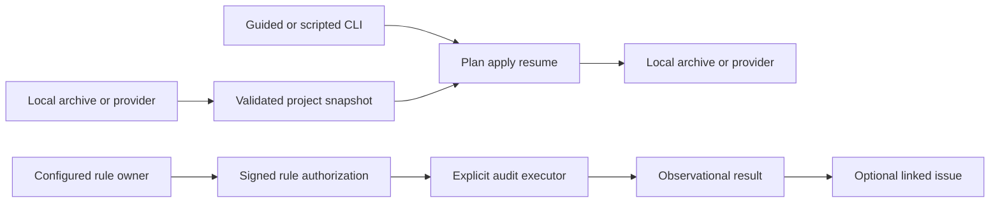

# Implementation plan: portable collaboration and independent audits

Date: 2026-10-26. Integration target: `feat/portable-collaboration`.
Inputs: [spec.md](spec.md), [research.md](research.md), [data-model.md](data-model.md).

## Technical context and answered questions

Use Go 1.26+, the standard library and Git 2.x; introduce no external Go module,
Python, provider CLI, mandatory service/database or Docker dependency. Deliver
three independent capabilities: deterministic release tooling, portable project
migrations, and explicit nonblocking audits. Scheduling/batching follow later.
Existing native defaults, signed encodings, required-check semantics, public
release artifacts and tags remain unchanged.

Storage remains Git objects and signed actor histories. Portable archives add
bounded canonical manifests/blobs; private plan progress stays below the resolved
Git directory. Reads need no signing identity. Writes use the existing signer,
expected-old ref guards, actor-scoped operation keys and quarantine boundaries.

## Architecture

### A1: canonical project snapshots above current transfer graphs

Add `internal/migration` for provider-neutral values, bounded archive/plan/progress
validation and source/destination contracts. It imports no provider clients or
root package. Root `migration_*.go` bridges existing signing, native resources and
quarantine; optional adapters own API DTO translation. Keep legacy
`internal/forge.Provider`, resource readers and `hn transfer` compatible.

Snapshots have two layers: exact selected Git/native histories with dependency
closure, and attributed foreign records with content-addressed downloaded blobs.
The existing typed graph cannot represent project-wide Git history, PR/MR
conversations or downloaded attachments; do not flatten those into issue bodies.
Foreign records remain locally inspectable without adapters and never become
native reviews, CI passes, identities or authority.

Export explicit selected refs/dependencies, never `git bundle --all` or filesystem
`.git` contents. Exclude ambient/private identity stores, credentials and journals;
selected committed history remains exact rather than implicitly secret-scrubbed.
Stage imported objects in an isolated bare quarantine. Validate archive shape,
limits/digests, signatures, actor chains, event trees and dependency closure before
accepted visibility. Promote only designated remote-observation refs with
expected-old guards, never local signing-owned actor streams.

Historical policy/pipeline/code objects necessary to verify facts remain
available. Activating imported governance is an explicit separate decision,
including in new local repositories. Existing policy/identity/worktree state is
preserved unless the plan explicitly resolves the relevant conflict. No blanket
reset, force push or source deletion. Offline closure includes unmerged candidate
heads and audit target/rule objects, not just a selected main branch.

### A2: one saved plan and guarded progress engine

Guided `hn migrate` and explicit plan/apply/resume/inspect paths share one engine.
Read-only planning may write an explicitly requested plan file, but cannot publish
native refs, create identities or mutate providers. EOF never grants approval.
Plans bind complete source observations, destination identity/baselines, scope,
capabilities, specific loss/mapping decisions and ordered intended writes; they
contain no ambient secrets and never silently refresh on resume.

Reuse prepared/in-flight/confirmed discipline from `forgeExecuteRemoteIntent`:
persist intent before the one side effect, then confirm exact observed identity.
An uncertain create permits positive reconciliation or manual recovery; negative
lookup is not proof permitting another create. Private progress binds plan and
actor, and is lock protected. Git refs, filesystem writes and independent APIs
are not one global transaction: use bounded preflight, scoped atomic promotion
and inspectable partial progress, including actual-ref checks after lost acks.

### A3: nonvacuous provider profiles and an adapter-free build

Freeze [migration-v1.md](contracts/migration-v1.md) before parallel adapters.
Every adapter provides tested applicable capability profiles, complete bounded
pagination, immutable identity distinct from display selectors, scoped credential
handling and recovery. Preserve-only coverage differs from destination creation;
unread content is unavailable, never preserved.

Mandatory baselines: GitHub/GitLab/Forgejo/Gitea issue+comment read/write; Azure
explicitly mapped work-item+comment read/write; Bitbucket Cloud repository,
PR-conversation snapshots and workflow source, with removed issues explicitly
unsupported. Also preserve applicable available PR/MR conversations, planning,
discussions and workflow source; unsupported native/destination mappings are
reported before writes. An all-unsupported adapter does not satisfy coverage.
Azure accepts supplied bearer/PAT credentials and explicit Services/Server API
versions; no deprecated OAuth app registration is introduced. GitLab self-hosted
endpoints and Forgejo/Gitea separate compatibility profiles are required.

Keep `nogithub` meaning exclude GitHub; add `noforge` excluding all network
adapters. Registration performs no network/credential I/O. Only an explicitly
selected adapter reads its credentials. Local archives, foreign record inspection,
ordinary native collaboration and audits work under `noforge`.

### A4: separate observational audit authority and execution

Add strict `audit.rule-authorize`, `audit.rule-revoke`, `audit.request` and
`audit.result` facts; preserve existing signed encodings. They never qualify as
`run.result` or merge/acceptance evidence. Integrate local writers/readers,
`store.go`, `event.go`, `quarantine.go`, `shallow.go` and migration admission
consistently, including explicit bounded log/tree/reference rules.

An optional committed `audits` policy declares scope, rule owners, requesters and
executors. Operator-selected authority is separate from target/rule source, so a
candidate or collaborative workflow cannot select its own owners. A sole owner
may authorize their own rule; protected-check nonauthor review exclusion is not
misapplied. Explicit successor/revocation graphs retain history, expose concurrent
heads and refuse new execution on conflicts/revocation/stale authority. See
[audits-v1.md](contracts/audits-v1.md).

Sources initially are committed local pipelines, exact native workflow revisions
or explicitly already-present external Git revision/path; none is fetched or
executed implicitly. Reuse `executePipeline` below proposal-specific guards,
separating target extraction from authorized definition bytes. Keep sandbox
default, explicit unsafe-host opt-in, environment, timeout and log limits.

Follow-up dedup uses scope + stable rule + finding key, not result time/digest.
Signed issue metadata retains finding/request/result links; existing actor-scoped
issue operations support retry. Reprocessing returns the known association
without silently overwriting edited issues. Concurrent independent publishers
remain visible; no distributed exactly-once lock or canonical private index.

### A5: Go release command/library

Add `cmd/hn-release` and `internal/release`; invoke Go/Git with argument arrays,
never a shell. Build an exact committed tree in isolation with controlled flags,
CGO disabled and module networking off. Record source/compiler/version/target/
variant provenance. Normalize archive metadata, order, modes, gzip and checksums.
Use Go archive libraries on all hosts. Existing development version remains the
default if converted to a variable for explicit validated linker injection.
No packaging command publishes, modifies policy or changes tags. See
[release-v1.md](contracts/release-v1.md).

## Implementation concern map and reviewable sequence

Concerns are architectural; tasks authoring owns WP metadata and execution lanes.

| Concern | Package boundary / principal requirements | Proposed WP | Dependencies |
| --- | --- | --- | --- |
| IC-01 | Go-only packager; FR-021 | WP01 | none |
| IC-02 | Audit types/owner policy/admission; FR-016/018/019 | WP02 | none |
| IC-03 | Audit execution/follow-up; FR-017/020 | WP03 | WP02 |
| IC-04 | Snapshot schema/archive/native closure; FR-002/003/004 | WP04 | none; audit-kind integration after WP02 |
| IC-05 | Plan/apply/resume and local/archive bridge; FR-005/007/013/014 | WP05 | WP04 |
| IC-06 | Adapter contract/conformance/GitHub; FR-008/009/015 | WP06 | WP05 |
| IC-07 | GitLab mappings | WP07 | WP06 |
| IC-08 | Separate Forgejo/Gitea profiles | WP08 | WP06 |
| IC-09 | Available Bitbucket Cloud coverage | WP09 | WP06 |
| IC-10 | Azure DevOps mappings | WP10 | WP06 |
| IC-11 | Guided/scripted migration; FR-006 | WP11 | WP05–WP10 |
| IC-12 | Integrated acceptance/docs; FR-001/022 and NFRs | WP12 | WP01–WP11 |

Audit event/store/quarantine/shallow changes stay in one dependency chain. Freeze
common interfaces before provider work; adapters mainly add provider-owned files.
Packager, audit foundation and snapshot values may proceed independently where
files do not overlap. Do not add scheduler/batching functionality in this mission.

## Validation and charter check

No charter exception is requested. Snapshot defaults follow the spec; additional
Git defaults are 100,000 objects, 16 MiB/object and 512 MiB aggregate native
material. Refuse incomplete success on limits. Native archive acceptance tests
include private-state exclusion, exact signatures/dependencies, hostile paths,
corrupt/dangling objects, policy adoption choice and stale destination guards.

Use local provider fixtures and temporary Git remotes, including public CLI
GitLab→GitHub, guided EOF refusal, meaningful provider baselines, attachment bytes,
uncertain creates and offline `noforge` continuity. No real provider mutations.
Audit tests prove sole-owner approval, refused candidate self-authorization,
current revocation, historic readability, failed nonblocking audits and dedup.

Every Go-changing WP satisfies charter gates before review: formatting, full race
suite, vet, build and diff checks. Reuse evidence at fixed source revisions and
do not run duplicate full suites concurrently. Integration includes ordinary,
`nogithub` and `noforge` binaries and exact archive digest reproducibility across
two independent temporary build paths. Actual platform tests and cross-compilation
are reported separately; unexercised Windows/macOS packager hosts remain explicitly
unverified. A portable packager does not imply Windows CLI distribution or a
portable safe CI backend. Publication remains a separate action.
