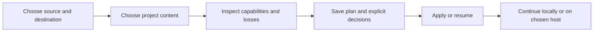

# Portable collaboration and independent audits

**Created**: 2026-10-26  
**Branch / integration target**: `feat/portable-collaboration`  
**Status**: Specification for implementation  
**Change mode**: New capabilities, preserving existing native behavior  
**Backlog source**: [Deferred audits, issue 13](https://github.com/LynnColeArt/hubnot/issues/13), plus the accepted migration vision and next-release packaging requirement from this conversation.

## Intent and scope

The user owns a project's code and communications independently of hosting.
Hubnot must let that user bring a project home, continue locally, retain an
offline copy, or move between supported providers. The migration tool asks what
to do and shows an inspectable plan before writing. Native collaboration remains
usable without any provider, account, service, scheduler, or network adapter.

This mission also fills the independent-audit gap: audit existing code later,
record nonblocking findings, and deliberately turn findings into follow-up work
while protecting rule ownership independently from merge prerequisites.

Finally, replace first-release Python packaging with Go-and-Git-only tooling
that itself runs on Linux, macOS, and Windows. Published `v0.0.1-dev` artifacts
and tags remain immutable. A Windows packager does not imply Windows CLI release
support or platform runtime qualification.

Provider targets are GitHub, GitLab (including explicit self-hosted endpoints),
Forgejo/Codeberg, Gitea, Bitbucket Cloud, and Azure DevOps. Support means tested,
declared capabilities against the actual provider model, not guessed equivalence
for every resource. Inaccessible or unavailable content must be reported as
missing/unsupported, never claimed as preserved. Provider-specific commercial
features and historical APIs that no longer exist are not invented.

## User scenarios and acceptance examples

### S1 — Own and continue a project locally (P1)

Given an explicitly selected project, when the operator exports a portable copy
and imports it into a new local repository, then selected Git history and native
signed facts are retained exactly, available foreign communications and attachments
remain inspectable, and local work continues with providers and credentials absent.
Existing destination identities and policies are not silently replaced. Historical
policy objects needed to verify signed facts remain in the preserved history;
activating a source policy in a new local checkout is a separate explicit choice.

### S2 — Move between providers (P1)

Given a hosted project and a different destination, when the operator previews
and approves mappings, then the tool transfers supported content, preserves
retrieved unsupported material locally, reports losses/dependencies, and can
resume interrupted progress without blindly repeating uncertain remote creates.
The source is not deleted. A GitLab-to-GitHub scenario proves cross-provider
operation rather than a same-provider copy alone.

### S3 — Be guided, or automate the same plan (P1)

Given an interactive terminal, the tool asks for source, destination, scope and
mapping/loss decisions, and presents the resulting plan before apply. Given
explicit command arguments and a saved plan, the same engine executes without
prompts. Missing answers on a noninteractive input fail with actionable guidance;
end-of-file never grants approval. Dry runs do not mutate native or remote state.

### S4 — Audit after merge without a new gate (P1)

Given a project that opts into independent audit work, when an authorized actor
requests and executes an audit against a resolved code snapshot, then the signed
result records what was checked and its findings without affecting proposal
readiness, approvals, acceptance, or merging. Changing a protected rule still
requires its designated approval regardless of audit execution timing.

### S5 — Turn findings into work (P1)

Given a failed audit, the operator can explicitly create linked native issues.
Retries and repeated finding processing do not create an issue flood. Another
actor can inspect the audit and work the issue after ordinary Git replication.
Concurrent independent publishers are reported honestly rather than promising
distributed exactly-once writes.

### S6 — Package without Python (P1)

Given a clean source revision and only the supported Go toolchain and Git, an
operator can create Linux and macOS archives, manifests, source, and checksums
using release tooling that runs on Linux, macOS or Windows, without Python,
provider CLIs, or Unix-only command interpreters. No packaging operation publishes
a release, changes a tag, or changes project policy implicitly.

## Functional requirements

| ID | Requirement | Status |
| --- | --- | --- |
| FR-001 | Preserve existing native commands, trust, defaults, signed facts, explicit execution, and required-check semantics. All new automation/transport is opt-in. | confirmed |
| FR-002 | Provide an inspectable portable project snapshot covering explicit selected code refs/history, native signed collaboration histories, attributed foreign resource records and retrieved attachments. Exclude Hubnot-managed private identities, ambient credentials, transfer journals, unrelated refs and working-tree junk. Intentionally selected committed history remains exact; this is not a secret-scrubbing promise. | confirmed |
| FR-003 | Native facts retain exact signed bytes and identities; archive import validates before visibility and never installs imported actors as local signing identities, silently adopts policy, or manufactures authority. Preserve historical policy objects for evidence verification; require an explicit decision before source governance is activated in a new destination checkout, and preserve existing destination governance. | confirmed |
| FR-004 | Preserve retrieved foreign issues/comments, PR/MR conversations/reviews, discussions, planning data and workflow source as attributed local records when native or destination equivalence is unavailable. Preserve retrieved attachment bytes with verified content digests. | confirmed |
| FR-005 | Support local repository, portable archive and hosted provider sources/destinations through the same migration engine; source observations and mapping/loss decisions are saved independently from secrets. | confirmed |
| FR-006 | Guided migration asks source, destination, scope and mapping decisions, then previews before explicit apply. Explicit arguments/saved plans expose equivalent noninteractive functionality. | confirmed |
| FR-007 | Report per-provider capabilities and per-plan mapped, preserved, requires-mapping, unsupported, missing-dependency and conflict findings before writes. Any loss or non-equivalent mapping requires an explicit decision; unread data is not preserved data. | confirmed |
| FR-008 | Keep current explicit transfer commands compatible and make adapter extension documented and testable through common interfaces/conformance cases rather than provider conditionals throughout native code. | confirmed |
| FR-009 | Cover GitHub and GitLab project snapshots and applicable imports/exports, including GitLab self-hosted endpoints. Verify a genuine GitLab-to-GitHub flow with isolated provider fixtures. | confirmed |
| FR-010 | Cover Forgejo/Codeberg and Gitea through separate tested capability profiles; shared transport does not imply untested API equivalence. | confirmed |
| FR-011 | Cover Bitbucket Cloud's available repository, PR-conversation and workflow-source interfaces. Explicitly report the removed issue tracker unavailable; do not silently substitute Jira or invent historical data. | confirmed |
| FR-012 | Cover Azure DevOps with explicit organization/project/repository selectors and work-item type/state mappings. Do not equate repositories, work items and planning projects. | confirmed |
| FR-013 | Persist guarded progress and support explicit resume. An uncertain write is reconciled by exact positive evidence or requires operator intervention; timeout/negative lookup never authorizes a blind duplicate create. Source deletion and background sync are outside migration. | confirmed |
| FR-014 | Foreign workflows remain inert source documents unless explicitly converted and separately authorized for native execution. Imported reviews, users, permissions and CI records never grant native approval, runner or maintainer authority. | confirmed |
| FR-015 | Provide an adapter-free build in addition to preserving the existing meaning of `nogithub`; native collaboration, local archives, audits and imported records work without network adapters. | confirmed |
| FR-016 | Add distinct signed audit requests/results for resolved code snapshots and identified rule revisions, independent of proposals. Audit facts are never eligible merge/acceptance evidence. | confirmed |
| FR-017 | Execute audit work only through explicit commands using the existing sandbox/unsafe-host boundary; no initialization, import, upgrade, proposal or merge starts audit work or a service. | confirmed |
| FR-018 | Record audit requester/executor, code/rules provenance, outcome, bounded evidence/logs and stable findings. Reads and replication validate the same relationships and permissions as local writes. | confirmed |
| FR-019 | Keep protected rule-change authority independent of audit scheduling. Rules evolve through authorized revisions; arbitrary imported or collaboratively edited workflow content does not bypass rule ownership. | confirmed |
| FR-020 | Optionally create linked native follow-up issues from audit findings, with inspectable finding identity, bounded processing, actor-scoped retry/recovery and explicit concurrent-publisher limitations. | confirmed |
| FR-021 | Replace Python archive packaging with Go/Git tooling portable to Linux/macOS/Windows, deterministic archive metadata, source/target/toolchain provenance, binary/source archives and SHA-256 checksums. Report actual host execution separately from cross-compilation; no unavailable host is claimed runtime-qualified. | confirmed |
| FR-022 | Document command contracts, provider capability/mapping limits, offline use, audit independence, rule ownership, recovery, packaging requirements and platform verification in the same delivery. | confirmed |

## Non-functional requirements

| ID | Requirement | Status |
| --- | --- | --- |
| NFR-001 | Snapshot operations use explicit positive budgets. Initial defaults: at most 10,000 records, 1,024 attachment blobs, 16 MiB per attachment/manifest, and 256 MiB total attachment data; archive expansion and Git object traversal use separately bounded documented budgets. Exceeding a bound refuses incomplete success. | confirmed |
| NFR-002 | Reject traversal/absolute paths, duplicate archive entries, symlinks, unexpected members, mismatched digests, oversized/decompression bombs and partial native histories before accepted visibility. Cross-origin credential forwarding and unbounded pagination are forbidden. | confirmed |
| NFR-003 | Changes pass formatting, full Go race tests, vet, build, diff checks and meaningful public CLI acceptance in ordinary, `nogithub` and adapter-free builds. Recovery/hostile input tests assert visible state preservation. | confirmed |
| NFR-004 | Rebuilding release archives twice with the same declared inputs produces identical digests; cross-compile the packager for Windows and macOS and test archive formats/contents independently of the host. Runtime qualification is reported only for platforms actually exercised. Where a host is unavailable, record the remaining qualification gap explicitly; cross-compilation cannot satisfy a host-runtime claim. | confirmed |

## Constraints and non-goals

- Implement product, adapters and release tooling in Go using the standard library and Git; no new external Go modules, Python, provider CLI, required service/database, Docker or mandatory background worker.
- This mission's target is the feature branch, followed by a reviewable PR. Existing public releases/tags and immutable historical protocol facts are not rewritten.
- Scheduling, queue workers, batching and compute-budget automation are subsequent audit work. Establish explicit request/result/follow-up semantics first.
- No automatic credential/account provisioning, source deletion, hosted permission migration, secret migration, or live user-provider mutation is performed during development acceptance.
- No universal CI-language conversion, stable runtime plugin ABI, provider API emulation service, or false claim of lossless equivalence.
- External rule repositories may supply explicit authorized revisions, but are never mandatory. The initial rule-source/owner contract must be documented and tested rather than guessed.

## Key concepts

- **Project snapshot**: the explicitly scoped code, signed native facts and attributed foreign content observed for a migration.
- **Migration plan**: immutable observations, intended destination changes, capability findings and explicit operator decisions; contains no secrets.
- **Foreign record**: locally inspectable source content and relationships attributed to a provider observation, never native trust-bearing evidence.
- **Audit request/result/finding**: independent observational work tied to inspected code and authorized rules; findings may become deliberate follow-up issues.
- **Provider capability**: a tested resource/direction mapping with declared limits, not a promise that similarly named provider objects mean the same thing.

## Success criteria

1. A project can be archived, moved to a new local repository, inspected and worked with all adapters/credentials absent, without losing selected native signed bytes.
2. A saved guided plan completes a cross-provider migration and resumes uncertain operations safely; unsupported and inaccessible data remain explicitly visible.
3. Every named provider passes applicable shared conformance cases, including its genuinely unavailable resources and endpoint/identity differences.
4. Post-merge audit failures produce inspectable results and optional deduplicated follow-up work, while merge evidence/readiness remains unchanged.
5. Release packaging succeeds with Go and Git alone and produces deterministic verified artifacts; the first release remains unchanged.
