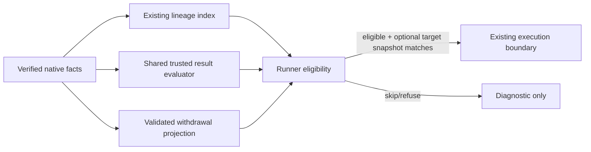

# Implementation Plan: Native Runner Efficiency

**Branch**: fix/runner-efficiency | **Date**: 2026-11-03 | **Spec**: [spec.md](spec.md)
Mission lifecycle consolidates into fix/runner-efficiency; final publication
uses a reviewed PR to main. Old worktrees/assets and unrelated user edits stay untouched.

## Summary

Preserve the default workflow first, then add queue usefulness checks using
existing lineage/governance semantics. Add an explicit signed withdrawal kind
with shared local/import validation and expose it through the CLI and runner.
An optional stale-base mode makes a bounded exact remote-ref observation.
No coordinator, daemon, provider integration or automatic default policy is added.

## Technical Context

**Language/Version**: Go 1.26 (installed go1.26.4); existing standard-library CLI.
**Primary Dependencies**: Git 2.x; existing optional sandbox backend.
**Storage**: Existing signed hn/0 actor facts in Git; no service database.
**Testing**: Real CLI/Git fixtures, backend marker files, race tests, native CI tiers.
**Target Platform**: Linux AMD64/ARM64 and Apple Silicon portability; no Windows/Intel expansion.
**Project Type**: Single Go CLI/module.
**Performance Goals**: No backend invocation for ineligible requests; reuse observed lineage and canonical trusted evidence instead of a second semantic model.
**Constraints**: Target probes <=15s and <=64KiB, cancellable/noninteractive; existing explicit execution and authority remain intact.
**Scale/Scope**: Two issue scenarios, one new explicit event kind, bounded regression corpus.

## Charter Check

HN-001: native Go/Git, no mandatory host/provider/database.
HN-002: requests/results bind exact candidate/definition/head/base policy.
HN-003: validate hostile facts, bound target probes and preserve sandbox/default moderation.
HN-004: never rewrite lineage or old signed results.
HN-005: wire/CLI/trust changes update protocol, compatibility and operator docs together.
Targeted staging; unrelated snapshot/stashes and old candidates remain unchanged.

## Component boundaries

- policy.go: extract pipeline evidence aggregation from evaluateProposal into
  a shared function without changing counted results, ordering or trust.
- runner.go and a focused runner eligibility module: index lineage once per
  observed event set; derive skip reasons, check configured pipeline satisfaction,
  preserve own-result skip and ungoverned explicit runs.
- A focused target-probe helper: --target refs/heads/NAME with
  --skip-stale-base is opt-in; validate exact branch ref and configured remote;
  observe fresh ls-remote result immediately before start, compare raw OID to
  signed base; no fetch/ref mutation/checkout inference. Missing or ambiguous
  result, deadline, cancellation and bounded-output refusal prevent execution.
  Reuse intentional cmdSync Git authentication semantics; disable interactive
  Git/SSH askpass and ambient object/config overrides without inventing credentials.
- run.withdraw: existing Subject=request ID, Body=reason (trimmed nonblank,
  <=4096 UTF-8 bytes); no repeated pipeline/head/definition. Strict new-kind
  shape and raw JSON validation, preserving all legacy signed bytes.
- One shared withdrawal relationship validator: available request kind, same
  signer/public key and later sequence; conflicting/duplicate authored
  withdrawal facts refuse rather than silently selecting an arbitrary winner.
  Local collection, quarantine and snapshot verification use the same rule.
- replicationEventReferences and shallow dependency classification include
  withdrawal->request dependency; import never mistakes missing history for absence.
- ci.go: hn run withdraw REQUEST --reason TEXT (optional --json if consistent
  with discovery contract), run help, run capabilities --json. Exact same
  request/reason retry returns original fact; changed reason refuses before
  signing. Publication remains explicit and output explains it.
- run list/show expose withdrawn status. Explicit run execute and automatic
  scheduling honor observed withdrawal, but already-signed results and merge
  evidence retain existing semantics. New requests may be explicitly executed
  even when automatic threshold suppression would skip them.
- contribution moderation preserves current runner prohibition and requester
  authority; static help/capabilities are keyless reads.

## Work packages / implementation concerns

| WP | Concern | Dependencies | Primary surfaces |
|---|---|---|---|
| WP01 | Default-workflow gate and canonical pipeline evaluation reuse | none | policy.go; focused tests/evidence |
| WP02 | Automatic eligibility and explicit bounded stale-base observation | WP01 | runner.go; runner eligibility/probe modules; CLI tests |
| WP03 | Signed withdrawal protocol, validation and portable closure | WP02 | event/store/quarantine/shallow/snapshot; protocol tests |
| WP04 | Withdrawal CLI, discovery, projections and execution integration | WP03 | ci.go, runner.go, main usage, moderation boundary; CLI tests |
| WP05 | Independent integrated acceptance, maintained docs and issue reconciliation | WP04 | docs, ci/fast-tests.txt, integrated CLI controls and mission records |

Use a single sequential lane/workspace because these WPs share core validation
and execution surfaces. Each WP is implemented by an agent and reviewed by a
different agent against a fixed head. The root orchestrator authors planning
and records scheduling/acceptance, not production implementation.

## Validation and rollout

WP01 first runs existing native fast/default/distributed-pipeline controls
before refactoring and preserves their passing behavior. Every WP requires
real focused race tests, diff-scoped gofmt, vet/build and diff checks at the
reviewed head; tests derive from observable contracts and have positive controls.
Final integrated evidence runs native fast, migration and integration tiers,
standard plus nogithub/noforge critical selections, legacy compatibility and
withdrawal replication/archive/shallow recovery cases. Full/stress/capacity/soak
work uses explicit native local CI; do not extend hosted PR test matrices or
add synthetic million-case loops. Record exact commands/head, scope and exits;
never describe a scoped suite as a full-suite pass.

Changes are source-only until a later separately requested release. Withdrawal
is only written by an explicit command; old readers may reject that new kind
and its actor-history advancement. Document this boundary and provide static
capability discovery, preserving ordinary old event semantics. No existing
release asset or historical qualification record is rebuilt or relabeled.

## Issue disposition

Both original issues begin in-mission and stay open until verified behavior is
merged. #27 closes when useful-lineage skipping, explicit stale-base semantics
and requester withdrawal are delivered. #30 closes for suppression after enough
trusted evidence has been observed; simultaneously starting runners remain an
explicitly documented limitation. Record a focused follow-up for native claim/
lease coordination if no existing tracker item covers it. Do not duplicate
unrelated open memory/hosting/Mac work or close it as collateral cleanup.

## Risks / non-goals

Withdrawal doesn't cancel in-flight external effects or invalidate history.
A remote target probe is a bounded snapshot, not a branch lock. Threshold
suppression is not exactly-once scheduling across partitions. Shared evidence
logic must preserve governance's latest-per-actor semantics and authorized
request matching. No new memory protocol, standing acceptance, server or
distribution-signing implementation belongs here.
