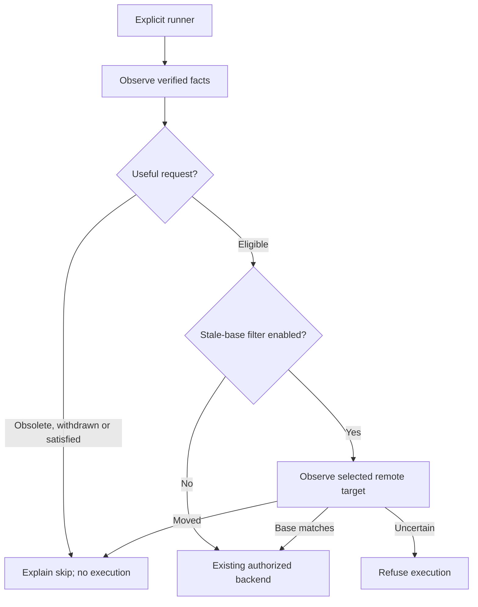

# Mission Specification: Native Runner Efficiency

**Mission Branch**: fix/runner-efficiency (mission consolidation); final PR target main.
**Created**: 2026-11-03
**Status**: Confirmed scope
**Input**: "Perfect. Let's package #27 and #30 as a runner-efficiency mission and work through it, keeping everything native and preserving the default Hubnot workflow. Let's close anything obsolete or duplicated"

## Intent Summary

An operator explicitly starts a native runner. After synchronization it should
spend capacity on useful pending work, explain skips, and honor requester
withdrawal before execution. Enough trusted evidence should suppress redundant
automatic runs. Ordinary Hubnot use remains inert and independent of providers.

The user confirmed this scope after reviewing [#27](https://github.com/LynnColeArt/hubnot/issues/27)
and [#30](https://github.com/LynnColeArt/hubnot/issues/30). Stale-base filtering is
explicit. Concurrent claims are a separate coordination design; result counting
does not promise exclusive execution. No discovery questions remain.

## User Scenarios & Testing *(mandatory)*

### User Story 1 - Preserve ordinary workflow (Priority: P1)

Existing users initialize, inspect and write collaboration without additional
policy, extensions, accounts or background services. Existing explicit runner
commands, sandbox defaults and ungoverned pipelines remain usable.

Acceptance: existing default-workflow and distributed-pipeline controls pass
first and at final integration. Help/capabilities are keyless reads and do not
start a worker, execute a pipeline, contact a remote or append a signed fact.

### User Story 2 - Execute useful queued work (Priority: P1)

After observing verified native facts, an explicitly started runner skips
superseded, merged, closed or conflicted proposal lineages. It also skips a
required pipeline already satisfied by enough latest qualifying trusted passes.

Acceptance: actual backend markers and result/ref snapshots prove skips have no
execution/result effect. Result counting matches governance across authorized
requests for the exact candidate, pipeline and definition. A later failure
replaces the same runner's earlier pass; untrusted/wrong evidence cannot suppress
work. An absent required policy pipeline preserves existing explicit execution.

### User Story 3 - Withdraw queued work (Priority: P1)

The original request actor explicitly signs withdrawal with a reason and
publishes it through normal sync. Observers display withdrawal and prevent
future explicit/automatic execution of that request.

Acceptance: unauthorized actors, missing dependencies and changed-intent retries
refuse before signing. Exact retries return the existing fact without append.
Existing signed results, decisions and merges remain valid. Already-running
processes are not cancelled by this feature.

### User Story 4 - Explicit stale-base filter (Priority: P2)

An operator chooses a full target branch ref and opts into stale-base skipping.
The runner observes that exact advertised ref from its configured remote before
execution, without fetching code, changing refs or inferring from local HEAD.

Acceptance: a moved base skips; missing, malformed, ambiguous, failed or timed-out
observation prevents execution. Without the option, target movement alone does
not add a skip. Observation is a snapshot, not a target lock.

### Edge Cases

Two simultaneous/disconnected runners can start before observing a result.
Withdrawal controls future starts, not past evidence. A fresh request is distinct
intent; automatic scheduling may still skip enough existing evidence, while
explicit execution of the new request remains available. Old readers may reject
an actor history containing the new withdrawal kind; no new kind is implicit.
Enabled contribution moderation retains its runner restrictions.

## Requirements *(mandatory)*

### Functional Requirements

| ID | Requirement | Priority | Status |
|---|---|---|---|
| FR-001 | Preserve default workflow, keyless reads, existing runner flags, ungoverned explicit runs and authority/backend gates. | High | Open |
| FR-002 | Reuse verified lineage semantics and skip superseded, merged, closed or conflicted candidates before backend start/result append. | High | Open |
| FR-003 | Share governance's latest-per-trusted-runner qualifying result evaluation; suppress automatic work only when its required policy pipeline is satisfied. | High | Open |
| FR-004 | Provide requester-only signed queued withdrawal with full request ID, bounded nonblank reason, verified chain/dependencies and duplicate-safe exact retry. | High | Open |
| FR-005 | Verify and carry withdrawals through local collection, selected Git replication, project archive transfer and shallow recovery. | High | Open |
| FR-006 | Show withdrawn status in run list/show and prevent future explicit/automatic starts, preserving historical results/decisions/merges. | High | Open |
| FR-007 | Offer explicit stale-base filtering against a fresh exact remote target observation; uncertainty prevents execution without changing local target state. | Medium | Open |
| FR-008 | Explain skip reasons; provide keyless static help/capabilities and document the explicit withdrawal writer compatibility boundary. | Medium | Open |
| FR-009 | Record concurrent-start limits, a separately scoped claims follow-up, and evidence-based original issue closure/deduplication. | Medium | Open |

### Non-Functional Requirements

| ID | Requirement | Status |
|---|---|---|
| NFR-001 | Target probes are cancellable, have a deadline at most 15 seconds and output bound at most 64 KiB, and disable built-in Git/SSH interactive prompts on supported transports. Explicitly configured credential helpers remain operator-trusted configuration, with bounded failure and no credential replacement. | Open |
| NFR-002 | Tests use real Git/CLI/backend markers and finite deadlines. Hosted CI keeps bounded portability scope; deep concurrency/capacity trials remain native/manual. | Open |
| NFR-003 | Refusal/skips preserve signed facts, refs and backend effects except normal pre-existing sync and documented private recovery diagnostics. | Open |

### Constraints

| ID | Constraint | Status |
|---|---|---|
| C-001 | Go/Git implementation; no required service, database, provider account/API, Docker, extension or background worker. | Open |
| C-002 | Preserve old signed bytes and history semantics; do not relax trust, evidence identity, moderation or execution isolation. | Open |
| C-003 | Preserve user files/stashes, previous mission worktrees and frozen/published release assets; stage only owned files. | Open |
| C-004 | Distributed claims/leases, interrupting in-flight effects, memory replay, standing acceptance, hosting and Mac distribution remain separate. | Open |

## Domain Language

A request binds one immutable candidate/pipeline/definition/commit. Satisfied
means enough latest passing trusted results under existing base policy.
Withdrawn means its original actor signed a future-start withdrawal. A skip is
an observation, never a passing/failing run result.

## Success Criteria

Original issue scenarios have public CLI evidence and positive controls.
Default workflow passes first/final. New facts round-trip; invalid histories
refuse. A second runner observing enough valid evidence does no backend work.
Review, acceptance, issue dispositions and retrospective precede closeout.
